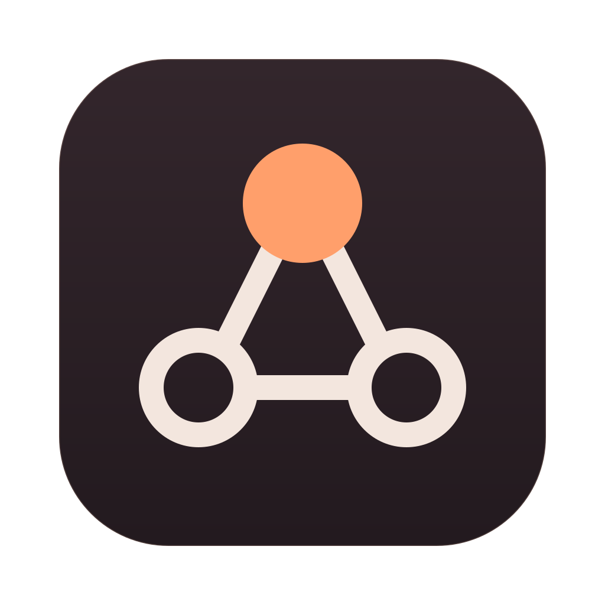
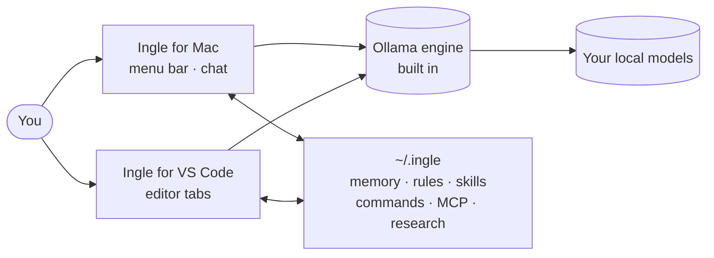

<div align="center">



# Ingle

### Your AI, kept at home.

**A native Mac app and VS Code extension for local AI models.**
Private by design. Free per message. Yours to shape.

[](LICENSE.md)


[](CONTRIBUTING.md)

[Get started](#-get-started) · [Features](#-what-it-does) · [How it works](#-how-it-works) · [Docs](docs/README.md) · [Contribute](#-contributing)

</div>

> [!WARNING]
> **Early preview.** Ingle is new and still being tested — expect rough edges, and builds that sometimes need a fix.
> It installs from source for now (no signed download yet), and the default models need about 32 GB of memory;
> on smaller Macs, pick smaller models in Settings → Models. Bug reports and pull requests are very welcome.

---

Cloud AI is brilliant, but every message leaves your machine, costs money and depends on someone else's
servers. Local models have caught up fast — yet running them still feels like a science project: a terminal,
a model name like `qwen3.6-35b-a3b-ud-iq4_xs`, a fan spinning while nothing's happening, and a chat box that
can't actually *do* anything.

**Ingle makes local AI feel like a proper assistant.** It gives your models names and personalities, puts them
in your menu bar and your editor, lets them read your files, edit your code, search the web and remember you —
and makes sure a 20 GB model isn't sitting on your memory when you're not using it.

Everything runs on your Mac. No accounts, no tracking, no subscription.

## ✨ What it does

### 🛡️ Commands: the obedience layer

Local models are clever but forgetful with tools. So Ingle has **commands** — rules it *enforces* rather than
suggests:

> *"Write a command to always use the Figma MCP for component builds."*

From then on, when you ask for a component, the Figma tools are guaranteed to be offered, banned tools are
blocked, and **the assistant can't finish until it has done what the command says** — Ingle sends it back if it
tries. Commands can also require running your linter or tests after every edit.

### 🔥 Meet Ember and Flint

Two assistants with real characters, not version numbers. **Ember** is the quick, warm pair programmer for
everyday coding. **Flint** is the calm senior engineer for hard problems. Rename them, rewrite their
personalities, or give *any* model its own name and character — Ingle always tells every model how the app
and its tools work, so nothing breaks when you make it yours.

### 🍎 A Mac app that lives in your menu bar

- **One click to switch models**, put them to sleep, or see CPU, memory and GPU at a glance.
- **Power-aware** — models unload after a timer, and Ingle warns before loading a big model on battery.
- **Built-in engine** — Ollama ships inside the app, starts by itself when you chat, and **updates from Settings**
  with a notification when a new version is out (checksum-verified, with one-click roll back).
- **A proper chat window** — streaming replies, thinking, syntax-highlighted code, history, and a context meter.
- **Drop anything in** — code, PDFs, Word, Excel, Pages and images (HEIC too). Models that can't see images get
  the text read from them on-device.

### 💻 A coding partner inside VS Code

- Opens as an **editor tab** from the Ingle icon at the top right of the editor — as many tabs as you like, each with its own chat.
- **Reads your project, searches code, sees your problems panel, edits files with a diff you approve, and runs commands.**
- A **repo map** — an outline of your project's files and key functions, ranked for every request — so a small
  model knows where things live without reading everything.
- Shares everything with the Mac app, and works without it.

### 🧠 It remembers, researches and follows your rules

- **Memory** — facts about you in plain Markdown files you can read and edit.
- **Web research** (read-only, when you switch it on) — and it saves short research reports so it never redoes work.
- **Skills and rules** in Claude's `SKILL.md` format, plus **MCP servers** — indexed in a tiny `INGLE.md`, so the
  model loads details only when needed.
- **Helpers** — hand a self-contained job to a read-only sub-agent.

### 🧩 Built for small models

Everything in Ingle is tuned for models that run on a laptop: only the tools a request needs are offered each
turn, long chats **compact themselves**, recommended sampling settings are sent for each model, repeated
mistakes are caught, and there's no arbitrary step limit — it keeps going until the job's done.

## 🚀 Get started

**You'll need** a Mac with Apple Silicon running macOS 14 or later — 16 GB of memory runs small models,
32 GB or more is comfortable for the 30B-class models Ingle suggests — plus Swift
(Xcode, or `xcode-select --install`). For the VS Code extension, Node 18+.

```zsh
git clone https://github.com/DemiInfinity/ingle.git
cd ingle
./build.sh --install                     # builds Ingle.app with its engine and copies it to Applications
cd Extensions/vscode && ./install.sh     # optional: the VS Code extension
```

Then click the Ingle icon in your menu bar → **Settings → Models** and download a model. Say hello.

> 💡 `INGLE_MLX=v3 ./build.sh` makes a smaller build (about 230 MB of engine instead of 580 MB) that still runs
> MLX models on macOS 14+. See [docs/engine.md](docs/engine.md).

## 🔍 How it works



Both apps talk to the same local engine and share one folder, `~/.ingle`, so your assistants, memory, skills
and commands follow you between your Mac and your editor. The full tour is in **[docs/](docs/README.md)**:
[architecture](docs/architecture.md) · [the agent loop](docs/agent-loop.md) · [commands](docs/commands.md) ·
[file formats](docs/ingle-home.md) · [engine](docs/engine.md) · [security](docs/security-and-privacy.md).

## 🔒 Privacy

| | |
|---|---|
| Accounts, analytics, tracking | **None** |
| Where your chats, memory and files live | **On your Mac**, in folders you can open |
| When Ingle goes online | Only when you switch on **Web**, download a model, or check for engine updates (once a day, can be turned off) |
| Actions on your Mac | Every file change, command and MCP call needs **your approval** |

Read the full [Privacy Policy](PRIVACY.md) and [Terms of Use](TERMS.md).

## 🤝 Contributing

Ingle is built in the open and contributions are very welcome — bug fixes, features, docs, prompts, or just
trying it on your Mac and telling us what broke.

1. **Fork** this repository (the *Fork* button at the top right).
2. **Clone your fork** and create a branch: `git checkout -b my-improvement`.
3. **Make your change** — [CONTRIBUTING.md](CONTRIBUTING.md) explains the code layout, the style and the checks to run.
4. **Push** to your fork and **open a pull request** against `main`.
5. We'll review it together, and once it's ready it gets **merged**. 🎉

Got an idea first? [Open an issue](https://github.com/DemiInfinity/ingle/issues/new/choose) — it's the best way
to talk it through before you build. Good places to start are in the [roadmap](docs/roadmap.md).

## 🗺️ Roadmap

Signed and notarised releases · automatic app updates · Windows and Linux support for the VS Code extension ·
checkpoints you can rewind to · an optional "bring your own API key" fallback for the hardest jobs.
See [docs/roadmap.md](docs/roadmap.md).

## 🙏 Credits

Ingle stands on the shoulders of **[Ollama](https://ollama.com)** — the open-source engine by the Ollama team —
which in turn builds on **[llama.cpp](https://github.com/ggml-org/llama.cpp)** and **[MLX](https://github.com/ml-explore/mlx)**.
Ingle wouldn't exist without them. Thank you.

## 📜 Licence

**Free for personal and other non-commercial use** under the
[PolyForm Noncommercial License 1.0.0](LICENSE.md). Want to use Ingle commercially? Get in touch for a
commercial licence. [LICENSING.md](LICENSING.md) explains it in plain words, including the licences of the
bundled engine.

<div align="center">
<br>
<sub>Made with 🔥 on a Mac, for people who'd rather keep their AI at home.</sub>
</div>
