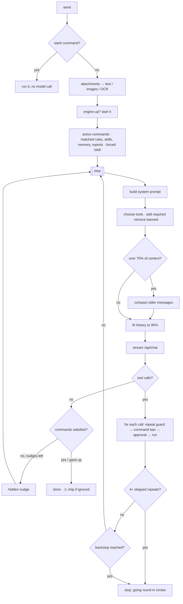

# The agent loop

The agent loop is the heart of Ingle: it turns your message into a prompt, chooses the tools, streams the model's
reply, runs the tools it asks for (with your approval), and keeps going until the job is done. It exists twice,
with the same behaviour:

| | Mac app | VS Code extension |
|---|---|---|
| Entry point | `ChatStore.send` → `generate(in:)` | `ChatEngine.send` → `generate` → `runLoop` |
| File | [`../Sources/Ingle/ChatStore.swift`](../Sources/Ingle/ChatStore.swift) | [`../Extensions/vscode/src/engine/chatEngine.ts`](../Extensions/vscode/src/engine/chatEngine.ts) |
| Tools | [`Tools.swift`](../Sources/Ingle/Tools.swift), [`ToolSelection.swift`](../Sources/Ingle/ToolSelection.swift), [`Memory.swift`](../Sources/Ingle/Memory.swift), [`WebTools.swift`](../Sources/Ingle/WebTools.swift), [`Knowledge.swift`](../Sources/Ingle/Knowledge.swift), [`Extensions.swift`](../Sources/Ingle/Extensions.swift) | [`src/tools/`](../Extensions/vscode/src/tools/) |
| Prompts | [`Prefs.swift`](../Sources/Ingle/Prefs.swift) (`Persona`), [`Manifest.swift`](../Sources/Ingle/Manifest.swift) (`IngleManifest`) | [`src/engine/prompt.ts`](../Extensions/vscode/src/engine/prompt.ts) |
| Commands | [`Commands.swift`](../Sources/Ingle/Commands.swift) | [`src/tools/commands.ts`](../Extensions/vscode/src/tools/commands.ts) |

## 1. Prompt assembly

Everything the model needs to know goes into **one system message** at the start of the history. Order matters
for small models (earlier text weighs more), so the persona and any COMMANDS come first.

### Before the first step (once per request)

1. **Active commands** — `CommandStore.active(for:project:)` / `activeCommands(listCommands(root), lastText)`.
   Any `skill:` requirement is attached in full (up to 12,000 characters). See [commands.md](commands.md).
2. **Forced skill** — a message starting `/skill-name` attaches that skill in full (`SlashCommands.skill(in:)`,
   `forcedSkill`).
3. **Matching** — `SemanticMatcher` / `Matcher` picks up to **3** candidates from memory files, research reports
   (newest 60), non-always rules and skills, using the last real user message plus the current file name and
   language. See [Matching](#matching-rules-skills-memory-and-reports) below.
4. **Editor context** — Mac: `EditorBridge.freshContext` (if the chat's editor chip is on). VS Code: a snapshot of
   the active editor (if the context chip is on).
5. **Repo map** (VS Code, and Mac Code mode) — `buildRepoMap` / `RepoMap.promptSection` with a budget of
   `min(6000, 0.4 × context)` characters (about a tenth of the context, at most ~1,500 tokens). See
   [vscode-extension.md](vscode-extension.md#repo-map) and [mac-app.md](mac-app.md#code-mode).

### The system message, Mac app

Built fresh every step in `generate(in:)`:

1. `## Summary of the earlier conversation` — if the chat has been compacted.
2. `Persona.systemPrompt(for:web:)` — name, the **facts every model gets** (it's local; Web on/off; Terminal is
   always available and asks first; the Mac button gates app control; Commands exist and are enforced; the
   companion app; use `ingle_help` for questions about Ingle) and then the user's character text.
3. `CommandStore.promptBlock` — the `## COMMANDS — you must obey these` block, if any apply.
4. `IngleManifest.refresh(...)` — the `INGLE.md` index (tools, always-on rules in full, rules index, skills,
   MCP servers, commands, research index, recent chat titles, memory index, your notes). Also saved to
   `~/.ingle/INGLE.md`.
5. Code mode: `Project.promptSection` (folder, git branch and status, the project's rules files) and the
   `## Repo map`. Otherwise `editor.promptSection` and `editor.projectInstructions` — what you're working on, and the project's
   `AGENTS.md` / `CLAUDE.md` / `.cursorrules` (8,000 characters each).
6. `## Effort` — the effort level's prompt line, if it has one (see [Effort and thinking](#7-effort-and-thinking)),
   then the Mode line (Edit, Auto, Debug, or `## Plan mode`) and `## Your task list` while the chat's list is unfinished
   (see [Task list, plan mode and steering](#4b-task-list-plan-mode-and-steering)).
7. `## Loaded for this request` — matched and forced rules, skills, memories and reports.
8. `MemoryStore.systemPrompt` (if memory is on), `WebTools.systemPrompt` (if Web is on),
   `KnowledgeTools.systemPrompt`, `MacTools.systemPrompt` (Terminal rules), and `MacTools.controlPrompt`
   (if the Mac button is on).

### The system message, VS Code

`ChatEngine.buildSystem`:

1. `personaPrompt` — same facts in meaning, worded for VS Code ("You're inside VS Code, helping them code").
2. `commandsBlock(active)`.
3. `indexPrompt` — built from the **tools actually offered this turn** plus rules, skills, commands, MCP servers,
   research and memory indexes and the notes at the bottom of `~/.ingle/INGLE.md`.
4. `editorPrompt` and `projectInstructions`.
5. `## Repo map`.
6. `## Loaded for this request` (memories, forced skills) and `## Possibly relevant` (suggested skills, rules, reports).
7. `guidancePrompt` — how to work (read before editing, prefer small `edit_file` replacements, one tool at a
   time, don't retry denials, web and memory guidance).
8. `## Effort` — the effort level's prompt line, if it has one; then the Mode line and `## Your task list` as on the Mac.
9. `## Summary of earlier messages` — if compacted.

### Matching rules, skills, memory and reports

`SemanticMatcher` ([`../Sources/Ingle/SemanticMatcher.swift`](../Sources/Ingle/SemanticMatcher.swift)) and
`Matcher` ([`../Extensions/vscode/src/engine/matcher.ts`](../Extensions/vscode/src/engine/matcher.ts)):

- **Skipped** for short or chatty messages (fewer than 3 meaningful words), such as "thanks" or "that's clever".
- **With `nomic-embed-text` installed:** embeds each candidate as `search_document: …` (cached by text) and the
  query as `search_query: …`, ranks by cosine similarity, and keeps up to 3 that are **clear winners**: a score of
  at least `max(0.70, mean + 2 × standard deviation)` across all candidates. (Loosely related texts often score
  0.55–0.65 with this model, so a fixed low bar let unrelated skills through.) With **fewer than 6 candidates** a
  single winner can't be 2 standard deviations out, so the bar there is `max(0.75, mean + 1 × standard deviation)`.
- **Without it:** keyword overlap (words over 3 letters, minus stop words), plus 2 if a word from the candidate's
  name matches; keeps the top 3 scoring **3 or more**.
- Off entirely when **Smart matching** is off (Settings → Extensions → "Suggest matching rules and skills").

**What happens to a match:**

| Match | What the model gets | On the reply chip? |
|---|---|---|
| Skill, rule, research report | One line under `## Possibly relevant`, naming the tool to open it (`use_skill`, `use_rule`, `report_read`) | Only if the model **opens** it |
| Memory | The memory text (up to 4,000 characters) under `## Loaded for this request` | No — memories are quiet context |
| Skill forced by `/skill-name` or required by a command | The full skill under `## Loaded for this request` | Yes |

The chip under a reply therefore shows **only what the assistant actually used**: skills and rules it opened,
research it read, skills you asked for, and ⚑ commands in force (⚠ if one wasn't followed). The Mac app tracks opened
items in `usedNames` (`ChatStore.generate`); VS Code pushes them onto `used` after `runToolCall`.

## 2. The tool catalogue

| Group | Mac app | VS Code | Approval |
|---|---|---|---|
| Files | `list_files`, `read_file`, `write_file`; in Code mode also `find_files`, `search_code`, `edit_file`, `get_problems`, `repo_map` | `list_files`, `read_file`, `find_files`, `search_code`, `get_problems`, `edit_file`, `write_file`, `read_document`, `view_image`, `repo_map` | Reads: free inside workspace folders (Code mode: the project), else asks. Writes and edits: always ask, with the diff on the card. Mac `get_problems` runs the check command, so it asks like `run_command`. |
| Commands | `run_command` | `run_command`, `open_url` | Always ask |
| Mac control | `open`, `applescript`, `screenshot` (only with the Mac button on) | — | Always ask |
| Web | `web_search`, `web_fetch` (only with Web on) | same | No (read-only) |
| Memory | `memory_search`, `memory_read`, `memory_save`, `memory_rewrite`, `memory_forget` | same | Saves/rewrites/forgets ask only if "Ask before saving" is on |
| Knowledge | `use_skill`, `use_rule`, `report_search`, `report_read`, `report_save` (Web on only) | same | No |
| Builders | `skill_create`, `rule_create`, `command_create` | same | Always ask |
| MCP | `mcp_tools`, `mcp_call` | same | `mcp_call` always asks |
| Past chats | `chat_list`, `chat_search`, `chat_read` | — | No |
| Help | `ingle_help` | — | No |
| Helpers | `delegate` | `delegate` | No (helpers are read-only) |

Full approval rules: [terminal-and-mac-control.md](terminal-and-mac-control.md#approvals).

Tool output sent back to the model is capped: Mac `run_command` 20,000 characters, `read_file` 100,000, documents
60,000, MCP 30,000, web pages 20,000; VS Code caps every tool result at 12,000 characters (`TOOL_OUTPUT_LIMIT`),
and `run_command` keeps the start and mostly the end (build errors are usually at the bottom).

## 3. Tool selection

Local models choose tools far less reliably as the list grows: in the RAG-MCP study, baseline selection accuracy
fell from about 85% with 5 tools to about 45% with 20. So each turn only offers what the message plausibly
needs. This is keyword-based, deliberately simple, and runs every step against the **last real user message**.

**Mac** — `ToolSelection.filter` ([`ToolSelection.swift`](../Sources/Ingle/ToolSelection.swift)) plus rules in
`generate`:

| Tools | Offered when |
|---|---|
| `memory_read`, `memory_rewrite`, `memory_forget` | the message mentions remember, memory, forget, "about me", "my preference", "note that"… (`memory_search` and `memory_save` are always there when memory is on) |
| `chat_list`, `chat_search`, `chat_read` | chat, conversation, earlier, last time, yesterday, "we talked", "you said", before… |
| `ingle_help` | ingle, setting, "how do I", "where is", shortcut, "menu bar", feature… |
| `delegate` | research, compare, "look into", investigate, summarise, "find out", helper, "in parallel"… (always at High/Max effort, never at Low) |
| `report_read`, `report_search` | there is at least one research report (at Low effort, also only when the message says report, research or earlier) |
| `mcp_tools`, `mcp_call` | the message says "mcp" or names a configured server |
| `skill_create`, `rule_create` | the message mentions "skill" or "rule" |
| `command_create` | the message mentions "command" |
| `use_skill` / `use_rule` | you have skills / non-always rules |
| `open`, `applescript`, `screenshot` | the Mac button is on |
| `find_files`, `search_code`, `edit_file`, `get_problems`, `repo_map` | Code mode (`repo_map` at Low effort only when the message says repo map, project structure, overview, codebase or architecture) |
| web tools, `report_save` | Web is on |

**VS Code** — `ChatEngine.toolsFor`: each `ToolDef.available(ctx)` first (web tools need Web, memory tools need
memory, `repo_map` needs an open folder, MCP tools need an enabled server…), then regular expressions for
`skill_create`/`rule_create` (`skill|rule`), `command_create` (`command`), `read_document` (pdf, docx, excel…),
`view_image` (image, screenshot, png…), `open_url` ("open … url/link/browser" or a URL), the memory editing tools,
MCP (`wantsMCP`), and `delegate` (research, compare, investigate…). The effort level's `strictness` changes this the
same way as on the Mac (strict also hides `repo_map` unless asked).

**Commands override selection.** Tools a command's `must_use` names are always added (for `mcp:` requirements,
`mcp_tools` and `mcp_call`; for `then_run`, `run_command`); tools in `never_use` are removed (`mcp:` bans are blocked per call instead). Required tools come from
everything the chat may use, so a switched-off tool (e.g. `web_search` with Web off) is never brought back; a command
that needs one is marked ⚠ straight away. See
[commands.md](commands.md#how-enforcement-works).

## 4. The loop and its guards

Each step streams one model turn. If it contains no tool calls, the request is finishing (after the command
check below). Otherwise each call is processed in order:

1. **Repeat guard.** A signature of the tool name and its arguments is counted (Mac: name plus arguments sorted
   by key; VS Code: name plus the JSON of the arguments). The **third identical call** (fourth at High and Max
   effort) isn't run; the model gets
   "You've already made this exact call N times… use that result, try a different approach, or tell the user
   what's blocking you", shown as *Skipped a repeated step*.
2. **Command ban.** A tool (or `mcp:server[/tool]`) in an active command's `never_use` returns "Blocked by the command …" (with what to use
   instead), shown with a raised-hand icon.
3. **Approval.** If the tool needs it and it isn't allowed for this session, the approval card appears and the
   loop waits. A denial returns "The user denied this action. Don't retry it; ask them what they'd like instead."
4. **Run** and append the result as a `tool` message (with images when the tool produced some).

After the calls:

- **Stuck detection.** When **4 or more** calls (6 at High and Max effort) have been skipped as repeats during this request, the run stops
  with "I seem to be going round in circles, so I've stopped. Tell me what to try next, or say 'carry on'…".
- **Thinking repetition.** If one response emits four consecutive copies of the same 24–256 character phrase in its
  thinking stream (including inline `<think>` text), Ingle stops that response and retries once with thinking off.
  The retry receives the conversation, the partial thinking as context, and instructions to answer directly; a note
  in the reply explains the retry. If thinking repeats again, Ingle stops and leaves the note visible. Optionally,
  a local decision model can also assess a short recent reasoning window every 768 characters; a high loop score
  triggers the same retry and marks the reply **Decider intervened**. If the decider is missing or fails, the
  exact-repeat guard still works.
- **Backstop.** There is no small step cap — local models cost nothing per step. The Mac app stops after 200
  steps; VS Code uses `ingle.maxSteps` (default 200, `0` = no limit) and says so when it reaches it.
- **Stop** cancels the stream, denies any open approval card and ends the loop.

**Checkpoints (undo a whole run).** One run = one `generate` (Mac `ChatStore.generate`, VS Code `ChatEngine.generate`),
with its own id. Every file-changing tool calls `Checkpoints.snapshot(path:run:)` / `snapshot()` after approval and
just before it writes, so the first change to each file copies its original to `~/.ingle/checkpoints/<chat>/<run>/`
(see [ingle-home.md](ingle-home.md#checkpoints)). Helpers are read-only, so they never snapshot. When the run ends
(finished, stopped or failed), `finish(run)` records each file's new state, and if anything changed the run's last
reply gets `checkpoint` (run id + what Undo would do per file). The chat shows the **changes panel** under it
(see [below](#4b-task-list-plan-mode-and-steering)), built on `changes(run)` → `[path, before?, after?]`, with
**Undo this run** (`restore(run, force:)`). If a file changed after the run, it says which and offers **Undo anyway**.
Regenerate keeps a reply that carries a checkpoint as an empty stub, so the earlier run's panel and Undo stay.

**Completion check (commands).** When a turn has no tool calls, every active command's requirements are checked
against the calls made during this request. If something is missing, Ingle adds one hidden "nudge" message listing
everything owed — "Ingle: before you finish, you still need to: - the command "X": … Do that now, then finish your
answer." — and loops. Each command gets **at most 2 nudges**; after that the reply is marked `⚠ didn’t follow X`.
A command whose required tool can't be offered at all gets `⚠ didn’t follow X (web_search isn’t available)` with no
nudges. Details in [commands.md](commands.md#how-enforcement-works).

**Errors** are turned into plain sentences (`ChatStore.friendly`, `friendly()`): engine unreachable, model not
downloaded, model can't use tools.

## 4b. Task list, plan mode and steering

The Claude Code-style workflow (task 32). Mac: [`TaskList.swift`](../Sources/Ingle/TaskList.swift),
[`ChangesPanel.swift`](../Sources/Ingle/ChangesPanel.swift) and the loop in `ChatStore.generate`; VS Code:
[`tools/tasks.ts`](../Extensions/vscode/src/tools/tasks.ts), [`engine/steer.ts`](../Extensions/vscode/src/engine/steer.ts),
[`tools/gitCommit.ts`](../Extensions/vscode/src/tools/gitCommit.ts) and `ChatEngine.runLoop`. The pure parts are tested in
`test/workflow.test.ts`.

- **Task list (`update_tasks`).** `items: [{content, status: pending | in_progress | done}]`, the whole list each
  time. Stored on the chat (`Conversation.tasks`, `StoredChat.tasks`), so it belongs to that chat's run. Parsing is
  forgiving (JSON text, `completed`/`in progress`/…, plain strings), keeps 12 items at most and only one in progress.
  The tool returns progress ("1/3 done. Now: …"). Offered from Medium up, always while a list is unfinished or in plan
  mode; never to helpers. While unfinished, the list goes in the system prompt as `## Your task list` (`[x]`, `[>]`,
  `[ ]`), so it survives compaction. It's shown pinned under the latest reply with ticks; a finished list is cleared
  when the next run starts, an unfinished one stays (e.g. for "carry on" after Stop).
- **Max's plan** asks for a numbered plan (no tools) as before, but the steps become the chat's task list
  (`tasksFromPlan` / `TaskList.fromPlan`: the last numbered list in the reply, ≥ 2 steps) instead of a **Plan**
  message. A one-line plan means no list. High's prompt line encourages a list for 3+ step jobs.
- **Modes** (task 32's revision; Mac [`WorkMode.swift`](../Sources/Ingle/WorkMode.swift), VS Code
  [`engine/modes.ts`](../Extensions/vscode/src/engine/modes.ts), tested in `test/workflow.test.ts`; Swift parity
  checked against the same cases). The **Mode** pill in the message bar, styled like Model and Effort, sets per chat
  (`Conversation.workMode`, `StoredChat.workMode`, optional: old chats are Ask) what may happen without asking;
  **⇧Tab** in the message box cycles it. The window (Mac toolbar) and the VS Code header show a badge when it isn't
  Ask, and the mode's line goes in the prompt.
  - **Ask** — as before: changes and commands each ask.
  - **Edit** — `write_file`/`edit_file` inside the project (Code mode's folder, or the editor's workspace) are
    approved automatically. Everything else asks as in Ask.
  - **Auto** — as Edit, plus `run_command` (and the Mac's `get_problems`) running inside the project, unless
    `riskyCommand` says why it must ask: sudo; `rm -r`/`-f`; `git push`, `reset --hard`, `clean`; network tools
    (curl, wget, ssh, scp, rsync, nc…); package installs and publishes; `| sh`, `bash -c`, `eval`; system changes
    (kill, launchctl, osascript, `defaults write`, chown…); any write or delete reaching a path outside the project;
    any `{{secret:…}}`; a working folder outside the project. Secrets, MCP, SSH, Mac control, links and outside reads
    always ask. An auto-approved call says **Auto approved** on its tool row (with the reason as a tooltip).
  - **Plan** — tools are cut to reading and searching plus `update_tasks` and `delegate` (VS Code: `readOnly` tools;
    Mac: `TaskList.planModeTools` — not `get_problems`, which runs the checks), and any other call, even one the
    model names without being offered it, is refused ("Plan mode is on: you can only read and search…"). Max's plan
    step is skipped. The last reply gets **Approve**: the chat goes back to the mode it had before Plan
    (`modeBefore`, usually Ask), `tasksFromPlan(reply)` becomes the task list, and "Approved. Go ahead with the
    plan…" is sent as your message. Replying instead keeps Plan, so the model revises the plan.
  - **Debug** — the task list starts as Reproduce → Find the cause → Fix → Confirm. `debugRefusal` refuses
    `edit_file`/`write_file` until the run has located the failure (any read, search, `run_command` or
    `get_problems`) and a reply has stated the cause in a line starting "Cause:". After an edit, finishing without a
    later `run_command`/`get_problems` gets a hidden nudge (the same mechanism as commands, at most two), then the
    chip `⚠ fix not confirmed`. Max's plan step is skipped.
- **Plan files.** A Plan-mode plan (≥ 2 steps) and Max's plan are saved as Markdown in `.ingle/plans/` (see
  [ingle-home.md](ingle-home.md#plans)) and shown as a card (Open, Edit, Approve). Approve reads the file, so your
  edits are what runs; `setTasks` ticks the file's checklist and status as the task list changes (`chat.planFile`).
- **Steer while it works.** Sending while this chat's run is going queues the message (per chat: VS Code
  `SteerQueue` on `EngineShared`, Mac `ChatStore.queued`), shown above the message box with × to take it back. At
  the top of each step — after the previous step's tool results, never between a tool call and its results
  (`canInsertNow`) — queued messages join the chat as user messages marked `steer` ("Added while it was working");
  the model sees them prefixed "(Sent while you were working — take it into account from here.)". If the model
  finishes while something is queued, the loop carries on instead of ending. Stop still ends the run; anything still
  queued goes back into the message box. Attachments and slash commands wait for the run to end.
- **Changes panel.** Under the run's last reply: **Changes · N files**, each Edited / Created / Deleted with +/−
  lines and its unified diff (Mac `DiffText`, Side by Side `SideBySideDiff`; VS Code inline, plus the diff editor),
  **Open in editor** (Mac: VS Code if installed, else the default app), **Undo this run**, and **Commit…**.
- **Commit.** Shown when every file of the run is in one git repository. The current model drafts a message from
  `git diff HEAD` of just those files (new files in full), `think` off; you edit it. **Commit** asks for approval
  (never for the session) showing `git add -A -- <files>` and `git commit [-s] -F <message> -- <files>`, then runs
  them, so only the run's files are committed even if other changes are staged. It never pushes. Sign-off is off by
  default (Mac: Settings → Mac Access → Commit button; VS Code: `ingle.commitSignOff`). The reply then shows
  "Committed <hash>".

## 5. Compaction and fitting the context

Ollama silently drops the start of a prompt that doesn't fit `num_ctx`. Ingle never lets that happen: it estimates
the size of every request and makes it fit first.

**Estimating.** Roughly 4 characters per token, about 800 tokens per image, plus a few per message. The system
prompt **and the JSON of the tool list** count, because both are sent with every request.

**Compacting at 75%.** If the estimate is over 75% of the context:

| | Mac (`compact(_:keepTurns:auto:)`) | VS Code (`compact(chat, auto, signal)`) |
|---|---|---|
| What's kept verbatim | the last 2 user turns; if still too big, just the last one | the last 2 real user turns (needs at least 3 to compact) |
| Transcript sent for summarising | capped at 2.5 × context characters: the first third and last two-thirds, "middle left out" | capped at 0.6 × 4 × context characters: the most recent part |
| Summary prompt | dense Markdown bullets: goals and preferences, decisions, files/commands/URLs, what was tried, open questions and next steps | the same headings, plus "keep exact identifiers, paths and numbers" (`COMPACT_PROMPT`) |
| Where it goes | an assistant message with `compactedCount`, inserted where the cut was | an assistant message with `compaction: { summarisedCount, auto }` |

The full messages stay visible above an **"Earlier messages summarised · N messages"** divider; the model only sees
the latest summary (in the system prompt) plus what came after it. A summary of a summary includes the previous
summary, so nothing is lost across repeated compactions. Manual compaction (**Compact** next to the meter, ⇧⌘K,
or `/compact`) summarises everything so far.

**Fitting to 90%.** After compaction, the history is trimmed to 90% of the context minus the fixed part:

- Mac `fit()`: first shortens the **oldest tool results** over 1,500 characters, then drops the oldest messages
  (never the latest user message), then any leading tool messages.
- VS Code `trim()`: first drops the oldest messages before the latest real user message, then leading tool
  messages, then shortens tool results over 2,000 characters.

**The context meter** under the message box shows the estimate (Mac: `contextUsage`; VS Code: the
`contextUsage` message) and offers **Compact** once it passes 40% (Mac).

## 6. Sub-agents

`delegate(task)` hands a self-contained job to a **helper**: a fresh conversation on the **same model**, with only
read-only tools, `think` off, at most **10 steps**, returning a concise result (findings, facts, sources).
Helpers run one at a time because only one big model fits in memory, and they can't start more helpers.

| | Mac `runSubAgent` | VS Code `runSubAgent` |
|---|---|---|
| Tools | `KnowledgeTools.subAgentAllowed`: web (if Web on), memory search/read, reports search/read, past chats, `use_skill`, `use_rule`, `ingle_help`, `list_files`/`read_file`; in Code mode also `find_files`, `search_code`, `repo_map` | every offered tool with `readOnly: true` (files, search, problems, documents, images, repo map, web, memory search/read, knowledge reads, `mcp_tools`) |
| Reading files | only inside workspace folders (whatever the Mac button says — Terminal reads are always on) | inside the project freely; outside asks you ("Helper: Wants to read …") |
| Command bans | applied (`CommandTracker.blockingCommand`) | applied (`bannedBy`) |
| Activity line | "Helper is thinking…", "Helper: Search the web…" | same |

## 7. Effort and thinking

The **Effort** pill in the message bar (Mac: `EffortMenu`, ⌘⇧E cycles; VS Code: the effort menu in the webview)
sets how hard the assistant tries **in this chat**. Each level is a bundle of settings, defined once per app —
[`Effort.swift`](../Sources/Ingle/Effort.swift) (`EffortLevel`) and
[`effort.ts`](../Extensions/vscode/src/engine/effort.ts) (`EFFORT`) — kept in step, and checked by
`test/effort.test.ts`:

| | Low | Medium | High | Max |
|---|---|---|---|---|
| Thinking (`think`) | off | on (`"low"` where the model takes levels) | on (`"medium"`) | on (`"high"`) |
| `## Effort` prompt line | "Answer directly in as few steps as possible." | (none) | "Investigate before changing anything: read the related code, then check your work. For a job of 3 or more steps, keep a task list with update_tasks." | "Plan first, investigate fully, verify with the project's checks, then review your own changes before finishing. Work through your task list and keep it current with update_tasks." |
| Tool filtering | strict | normal | relaxed | relaxed |
| Verify after editing | no | no | yes | yes |
| Plan first (into the task list) | no | no | no | yes |
| `update_tasks` offered | only while a list is unfinished | yes | yes | yes |
| Helper reviews the changes | no | no | no | yes |
| Repeat / stuck guard | 3 / 4 | 3 / 4 | 4 / 6 | 4 / 6 |

- **Defaults.** Per assistant, in Settings → Models: Ember Medium, Flint High (`Prefs.K.dailyEffort` /
  `hardEffort`, mirrored to `settings.json` as `assistants[].effort`). A new chat takes its assistant's default;
  switching assistant before the first message takes the new one's. The level is saved on the chat
  (`Conversation.effort`, `StoredChat.effort`, both optional). Chats from before effort levels: Think on → High,
  off → Medium (the Mac app never saved Think, so its old chats read as Medium).
- **Thinking.** Ollama's `think` takes `true`/`false` and, for some models (gpt-oss), `"low" | "medium" | "high"`.
  `EffortLevel.think(for:)` / `thinkParam()` send the level only to models that take one, `true` to the rest,
  `false` at Low. If a model rejects it, the request is retried as plain `true` (for a level), then without `think`
  at all (`OllamaError.thinkingUnsupported`, `ThinkUnsupported`) — so on a model that can't think, Low and Medium
  behave the same. Thinking arrives in a separate `thinking` stream and is shown collapsed ("Thought for Ns").
  Models that inline reasoning as `<think>…</think>` are split the same way (`ThinkSplitter` in
  [`MessageViews.swift`](../Sources/Ingle/MessageViews.swift); `InlineThink` in `chatEngine.ts`). Helpers,
  compaction and tab-title summaries always run with `think: false`. If a response repeats the same phrase four
  times in a row while thinking, Ingle stops it and retries with thinking off, passing the partial reasoning and
  conversation as context so the reply can still answer. Settings → Models can enable a local semantic loop decider
  (`strands-decider:2b-nvfp4` by default); it checks bounded recent windows and is optional. Its selected tag can be pulled
  again from that setting to apply registry updates or switch to a smaller/larger weight variant.
- **Tool filtering.** Strict (Low): the helper (`delegate`) is never offered, and `report_read`/`report_search`
  (and in VS Code `repo_map`) need asking for. Relaxed (High/Max): the helper is always offered. Commands still
  override this. See [Tool selection](#3-tool-selection).
- **Verify after editing (High, Max).** On the first allowed file change (`write_file`, `edit_file`), Ingle finds
  the project's check command — unless an active command already has a `then_run`, which then does the job. It walks
  up from the changed file (stopping at the workspace, never above your home folder) to the nearest folder with
  `package.json` (the `test` script, unless it's npm's placeholder, else `lint`; `pnpm`/`yarn` if their lock file is
  there), `Package.swift` (`swift build`), `Cargo.toml` (`cargo check`), `go.mod` (`go test ./...`), a Makefile with
  a `test:` target (`make test`) or pytest config (`pytest`). It then adds a built-in command called **verify**
  with that as its `then_run`, so the normal command checks enforce it: it appears in the COMMANDS block, the model
  is nudged (at most twice) if it tries to finish without running it after its last change, and the reply gets
  `⚠ didn’t follow verify` if it never does. No check command found: the reply gets the chip
  `verify skipped: no check command found`. The command itself still asks for approval like any other.
- **Plan (Max).** Before the first step, the model is asked (with the full system prompt, no tools) for a short
  numbered plan; its steps become the chat's **task list** (shown live, and in the prompt as `## Your task list`).
  A one-line plan or nothing back: the work goes ahead without a list. Skipped in plan mode.
- **Review (Max).** When the request finishes and files changed, Ingle runs `git diff HEAD` on those files itself
  (read-only; new files are shown in full), and a read-only helper (`runSubAgent`) reviews it against the request.
  Its notes are shown as a message starting **Review**, with a `helper review` chip.

## 8. Model tuning

`ModelTuning.options` ([`Ollama.swift`](../Sources/Ingle/Ollama.swift)) and `tuning()`
([`ollama.ts`](../Extensions/vscode/src/engine/ollama.ts)) send, on every request:

- `num_ctx` = the assistant's context length (default 32,768; per assistant in Settings → Models).
- For any model whose tag contains `qwen3`, the Qwen model cards' presets:
  - thinking: `temperature 0.6`, `top_p 0.95`, `top_k 20`, `min_p 0`;
  - not thinking: `temperature 0.7`, `top_p 0.8`, `top_k 20`, `min_p 0`.
- Both presets also set `presence_penalty 1.5` to discourage repetition, including loops in the thinking stream.

Other models get Ollama's defaults (plus `num_ctx`). Note that Ollama's Go runner has been reported to accept and
silently ignore the penalty options (ollama/ollama#14493), which is one reason the app-side repeat guard exists —
see [weaknesses-and-mitigations.md](weaknesses-and-mitigations.md#2-local-models-are-less-reliable-with-tools).

## 9. Vision and images

- **Detection:** `/api/show` capabilities include `vision`; cached per model (`visionCache`). If the engine is
  down the answer isn't cached, so it's asked again later.
- **Mac:** attached and tool images are converted to JPEG at most 1,600 px (`ImageStore`, HEIC included) and kept
  in `~/Library/Application Support/Ingle/images`. Vision models get them as base64 `images`; other models get the
  text read by Apple's Vision framework (`recognizeText`) appended to the message. `read_file` on an image and
  `screenshot` attach the image to the tool result.
- **VS Code:** `prepareImage` uses `sips` to make a JPEG at 1,600 px plus a 256 px thumbnail; non-vision models get
  OCR text via a small JXA script calling Vision. Images returned by `view_image` are sent in a short user message
  `(Image from view_image)` after that batch of tool results, because Ollama only accepts images on user messages.

## Trade-offs

| We chose | We gave up | Why |
|---|---|---|
| **Keyword tool filtering** per turn | Embedding-based tool retrieval (as in RAG-MCP) | It's instant, needs no extra model, is predictable and easy to debug, and gets most of the benefit: core tools stay, rarely-needed ones only appear when words suggest them. The cost is misses ("check what I said on Tuesday" won't offer past-chat tools unless a trigger word appears) and false positives. A `request_tool` meta-tool or embeddings could replace it later. |
| **No small step cap**, with repeat detection and a 200-step backstop | A predictable upper bound on time | A local model costs nothing per step, and long refactors genuinely need dozens of steps; a cap of 10–25 (common in cloud tools) would stop real work. Stuck runs are caught by the repeat guard instead. A model that loops with *different* arguments each time isn't caught until the backstop. |
| Skip the **3rd** identical call; stop after **4** skips | Running legitimate repeats (e.g. re-running tests after an edit is fine — the arguments match but the world changed) | Re-running the same `run_command` three times with nothing in between is almost always a loop with small models. The model is told why, so it can change approach. |
| **Compact at 75%**, fit to 90% | Using the last quarter of the window for history | The tool list, system prompt and the reply itself need room, and estimates are rough (4 chars/token). Compacting earlier means more frequent summaries; compacting later risks Ollama cutting the prompt silently. |
| Summaries written by **the same model** | A dedicated summariser | No second model in memory. A weak model writes weaker summaries — mitigated by a structured prompt that keeps paths, names and errors. |
| **Nudges capped at 2** per command | Guaranteed compliance | Unlimited nudging can loop forever when a model can't or won't comply; two tries fix most cases, and the ⚠ chip makes the failure visible rather than silent. |
| One **system message** rebuilt every step | Prompt caching across steps | Ollama keeps the KV cache for an identical prefix, so stable parts come first (persona, commands, index); volatile parts (matched context, summary) are near the end in VS Code. The Mac app puts the summary first, which can reduce cache reuse after compaction. |
| **Same model** for helpers | Parallel helpers on a small model | Only one big model fits in memory on most Macs; loading a second would evict the first. |
| **Auto** mode by a pattern list of risky commands | Sandboxing every command | A sandbox would block normal builds and tests; the list is short, readable and tested in both apps, and anything it doesn't recognise as risky still runs only inside the project folder. The cost: a cleverly disguised destructive command could slip through, so Auto is opt-in per chat and every auto-approved call is shown. |
| Steering messages join **at the next step** | Interrupting a step mid-stream | A tool call and its results must stay together for the model API, and stopping a half-written reply wastes work. The cost: a long single step (a slow command) delays your message until it ends — press Stop if it can't wait. |
| Plan mode by **tool filtering + refusal** | A separate planning model or prompt-only plan mode | Small models ignore "don't edit" in a prompt; taking the tools away (and refusing any that slip through) makes it reliable. |
| Three agent loops in step (Mac Chat, Mac Code, VS Code) | One shared core | Porting the coding tools and the workflow to Swift means the same logic in two languages; the pure parts are tested in TypeScript and mirrored. Task 9's shared fixtures are what keeps that safe; longer term the loop could move into one shared core. |
| Approximate token counting (chars/4) | Exact counts | Ollama has no cheap tokenise endpoint for every model; the 75%/90% margins absorb the error. |
