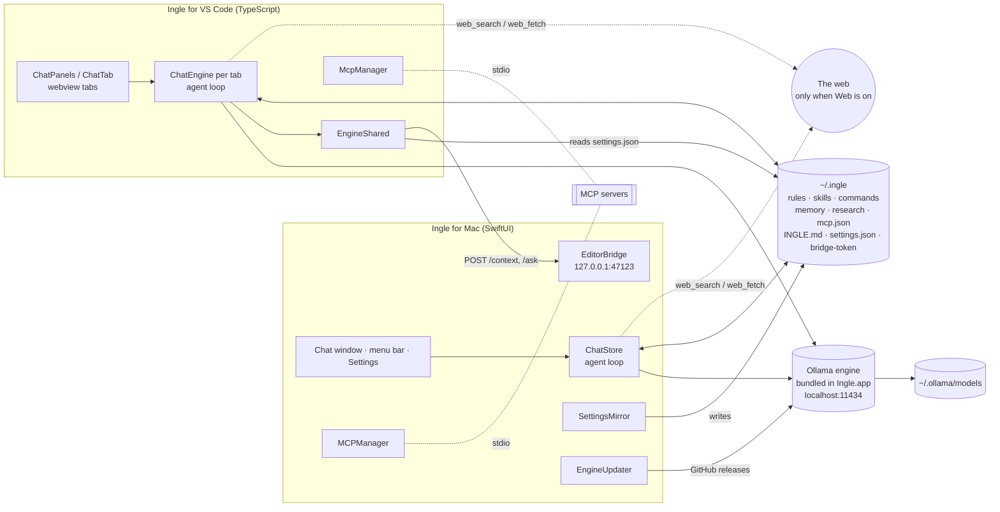
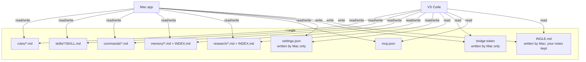
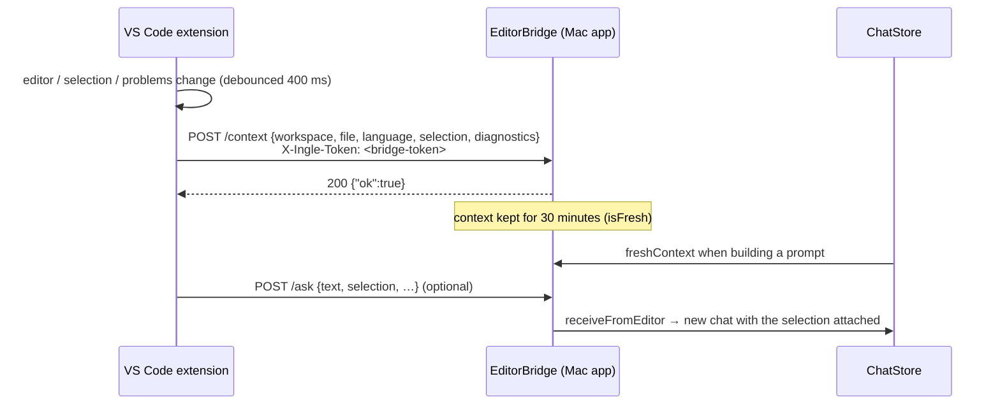

# Architecture

This page is the big picture: what the pieces are, how they talk, and what happens to a message from the moment
you press Return to the moment the reply finishes. For the details of each piece, follow the links.

## The pieces



| Piece | Where | Role |
|---|---|---|
| Ingle for Mac | [`../Sources/Ingle/`](../Sources/Ingle/) | Menu-bar app with a chat window. Owns the engine (starts, updates it), the settings, and writes the shared files. See [mac-app.md](mac-app.md). |
| Ingle for VS Code | [`../Extensions/vscode/`](../Extensions/vscode/) | Coding chat as editor tabs. Talks to the engine directly and works without the Mac app open. See [vscode-extension.md](vscode-extension.md). |
| The engine | `Ingle.app/Contents/Resources/OllamaRuntime/ollama` (or an updated copy in `~/Library/Application Support/Ingle/Engine/current`) | Ollama, MIT-licensed, runs the models over HTTP on `localhost:11434`. See [engine.md](engine.md). |
| `~/.ingle` | your home folder | Everything a user might edit by hand, shared by both apps. See [ingle-home.md](ingle-home.md). |
| Models | `~/.ollama/models` | Ollama's normal model store, so models are shared with any other Ollama install. |

### Two agent loops, one behaviour

There are two implementations of the agent loop: `ChatStore.generate` in Swift and `ChatEngine.runLoop` in
TypeScript. They are deliberately kept equivalent in behaviour (same prompts in meaning, same guards, same file
formats) but not shared in code, because one is a native SwiftUI app and the other runs inside VS Code's Node
host. [agent-loop.md](agent-loop.md) describes both side by side and lists where they differ.

**Rule for contributors:** if you change behaviour in one app, change the other to match, or say in the pull
request why not ([../CONTRIBUTING.md](../CONTRIBUTING.md)).

## Talking to the engine

Both apps use Ollama's HTTP API directly, with no SDK:

| Endpoint | Used for | Swift | TypeScript |
|---|---|---|---|
| `GET /api/version` | Is the engine up? | `OllamaClient.version` | `OllamaClient.version` |
| `GET /api/tags` | Installed models | `tags` | `tags` |
| `GET /api/ps` | Loaded models (menu bar state, memory) | `running` | — |
| `POST /api/chat` (streaming) | Chat, tools, `think`, `options` | `chat` / `streamChat` | `chat` / `stream` |
| `POST /api/show` | Capabilities (`vision`, `tools`, `thinking`) | `capabilities` | `capabilities` |
| `POST /api/generate` with `keep_alive` | Load / unload (sleep) | `load`, `unload` | — |
| `POST /api/pull` (streaming) | Download models with progress | `pull` | — |
| `DELETE /api/delete` | Delete models | `delete` | — |
| `POST /api/embed` | `nomic-embed-text` embeddings for matching | `SemanticMatcher.embed` | `OllamaClient.embed` |

Code: [`../Sources/Ingle/Ollama.swift`](../Sources/Ingle/Ollama.swift),
[`../Extensions/vscode/src/engine/ollama.ts`](../Extensions/vscode/src/engine/ollama.ts).

Every chat request carries `num_ctx` (the assistant's context length, default 32,768) and per-model sampling
`options` from `ModelTuning.options` / `tuning()`, so Ingle never relies on Ollama's own defaults. If a model
rejects `think`, both clients retry once without it.

## Shared state: `~/.ingle`



Everything in `~/.ingle` is plain Markdown or JSON, so you can read and edit it in any editor, and both apps pick
up changes on the next message (skills and MCP servers on `/skill-reload`). Formats are described in
[ingle-home.md](ingle-home.md).

Projects can add their own rules and commands in `<project>/.ingle/rules` and `<project>/.ingle/commands`; they
appear with a `project/` prefix.

What **isn't** shared yet: chat history. The Mac app keeps chats in
`~/Library/Application Support/Ingle/chats.json`; the extension keeps them in VS Code's private storage, per
workspace. Moving both to `~/.ingle/chats/` and `~/.ingle/coding/<project>/` is on the [roadmap](roadmap.md).

## The settings mirror

Settings are edited in the Mac app (UserDefaults, via `@AppStorage`). `SettingsMirror`
([`../Sources/Ingle/SettingsMirror.swift`](../Sources/Ingle/SettingsMirror.swift)) writes a JSON copy to
`~/.ingle/settings.json`:

- on launch, and 0.5 s after any `UserDefaults` change (debounced);
- whenever MCP servers, their status or their tools change (it watches `MCPManager` with Observation);
- only if the content actually changed;
- with file permissions `0600`, because it can hold a Brave Search API key.

The extension reads it with `loadSettings()`
([`../Extensions/vscode/src/shared/settings.ts`](../Extensions/vscode/src/shared/settings.ts)) every time it
builds a request, filling anything missing from built-in defaults, so it works when the file doesn't exist (for
example if the Mac app was never installed). The extension never writes it.

Contents: user name, the two assistants (id, name, model, persona, context length), autocomplete model,
`keepAlive`, `serverURL`, `enginePath`, web settings, memory settings, workspace folders, `useClaudeSkills`,
`smartMatching`, `mcpDisabled` and live `mcpStatus`. Example in [ingle-home.md](ingle-home.md#settingsjson).

## The editor bridge

The Mac app's chat window can know what you're doing in your editor, so "what's wrong with this?" works there too.



- **Listener:** `EditorBridge` ([`../Sources/Ingle/EditorBridge.swift`](../Sources/Ingle/EditorBridge.swift)) uses
  `NWListener` on port **47123**, restricted to the loopback interface. It parses just enough HTTP for three
  routes: `GET /ping`, `POST /context`, `POST /ask`.
- **Token:** every request must carry `X-Ingle-Token` equal to the contents of `~/.ingle/bridge-token`, a random
  64-hex-character secret created on first launch with permissions `0600`. Other local apps that can't read your
  home folder can't push text into your chats. See [security-and-privacy.md](security-and-privacy.md#the-editor-bridge).
- **Sender:** `extension.ts` posts a snapshot on editor, selection, diagnostics and window-focus changes, if
  `ingle.shareWithApp` is on (selection and problems have their own switches). If the Mac app isn't running the
  request simply fails after 1.5 s and is ignored.
- **Rider:** the same `EditorContext` can come from JetBrains Rider's window title instead (Accessibility
  permission, Settings → Extensions → Follow Rider). See [mac-app.md](mac-app.md#editor-context-vs-code-and-rider).
- **Effect:** when the context is fresh (under 30 minutes old) and the chat's editor context is on, the prompt
  gets a "What the user is working on" section and the project's `AGENTS.md` / `CLAUDE.md` / `.cursorrules`;
  project rules and commands come from `<workspace>/.ingle/`.

The extension's own chat doesn't use the bridge — it reads the editor directly.

## Companion: each app knows about the other

`Companion` ([`../Sources/Ingle/Prefs.swift`](../Sources/Ingle/Prefs.swift)) checks whether the extension is
installed (a `*.ingle-<version>` folder in `~/.vscode/extensions`, `~/.cursor/extensions` or
`~/.vscode-insiders/extensions`) and whether VS Code or Cursor is installed. `companionFact()`
([`../Extensions/vscode/src/engine/prompt.ts`](../Extensions/vscode/src/engine/prompt.ts)) checks for
`/Applications/Ingle.app`. The result becomes one line in the system prompt, so the assistant can suggest the
other app — once per chat at most, and only when it fits.

## A message, end to end

```mermaid
sequenceDiagram
    autonumber
    participant U as You
    participant L as Agent loop<br/>(ChatStore / ChatEngine)
    participant M as Matcher + stores (~/.ingle)
    participant O as Ollama /api/chat
    participant T as Tools
    participant A as Approval card
    U->>L: send(text, attachments)
    L->>L: slash command? attachments → text / images / OCR
    L->>O: engine up? (start bundled engine if not)
    L->>M: active commands for this message
    L->>M: match rules, skills, memory, reports (embeddings or keywords)
    loop until no tool calls (or stopped / stuck / backstop)
        L->>L: build system prompt (persona + facts, COMMANDS, index, editor, repo map, matched, summary)
        L->>L: choose tools for this turn; add required, remove banned
        L->>L: over 75% of context? compact, then fit()
        L->>O: stream(messages, tools, think, num_ctx, options)
        O-->>L: content / thinking deltas, tool_calls
        alt no tool calls
            L->>L: commands satisfied? if not, hidden nudge (max 2) and loop
        else tool calls
            L->>L: repeated 3rd time? skip with a note
            L->>L: banned by a command? block
            L->>A: needs approval? Deny / Allow for This Session / Allow
            A-->>L: decision
            L->>T: run the tool
            T-->>L: result (text, maybe images)
        end
    end
    L-->>U: reply, tool rows, ⚑ / ⚠ chips, tokens per second
```

Step by step, with code pointers, in [agent-loop.md](agent-loop.md).

## Trade-offs

| We chose | We gave up | Why |
|---|---|---|
| Two native implementations (Swift and TypeScript) of the same loop | Shared code; every change has to be made twice | A SwiftUI app and a VS Code extension can't share a runtime without bundling one inside the other (a Node runtime in the Mac app, or a Swift helper in the extension). Plain files in `~/.ingle` give most of the benefit of sharing with none of that weight. A shared TypeScript core and CLI are noted in the [roadmap](roadmap.md). |
| Plain Markdown/JSON files in `~/.ingle` as the shared "database" | Transactions, locking, change notifications | Users can read, edit, back up and version them; other tools (Claude's skills, Cursor's MCP config) already use the same shapes. Writes are atomic per file; concurrent edits of the *same* memory file from both apps can still lose a line. |
| The Mac app owns settings; the extension only reads `settings.json` | Editing assistants from VS Code | One writer means no conflicts. The extension has safe defaults when the file is missing. |
| A tiny token-protected HTTP bridge on loopback | Using the extension's own chat for everything | The Mac chat window is useful while coding, and the bridge is ~300 lines with no dependencies. Anything that can read `~/.ingle/bridge-token` (i.e. running as you) can still use it. |
| Talking to Ollama's HTTP API directly | An SDK, or embedding llama.cpp | No dependencies, and Ollama's model registry, chat templates and tool parsing come for free. The cost is that Ollama bugs (such as tool-call parsers) become Ingle bugs — see [weaknesses-and-mitigations.md](weaknesses-and-mitigations.md#2-local-models-are-less-reliable-with-tools). |
| Chat history kept separately per app | One history across both | It was simplest to ship; a shared store is planned ([roadmap.md](roadmap.md#shared-chat-storage-in-ingle)). |
