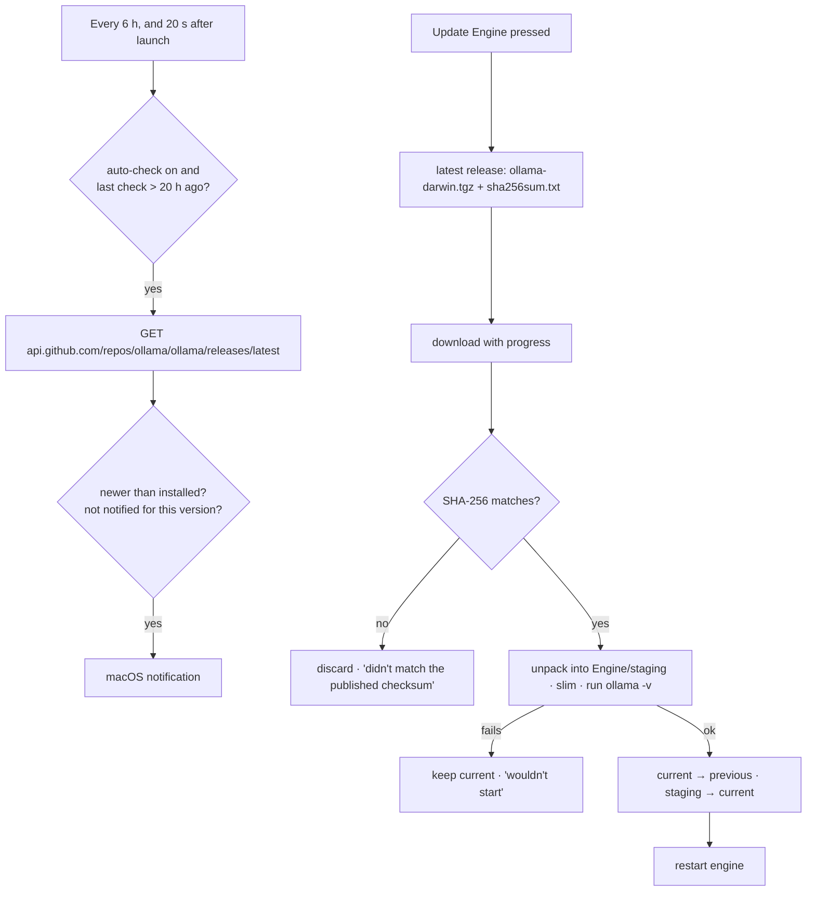

# The engine

Ingle runs models with **[Ollama](https://ollama.com)** (MIT licence), which builds on llama.cpp (GGUF models) and
MLX (safetensors/MLX models on Apple Silicon). The Mac app ships Ollama inside the app, starts it by itself and can
update it without a rebuild. The VS Code extension uses whatever engine answers, and can start the bundled one.

Code: [`../build.sh`](../build.sh), [`../Sources/Ingle/OllamaServer.swift`](../Sources/Ingle/OllamaServer.swift),
[`../Sources/Ingle/EngineUpdater.swift`](../Sources/Ingle/EngineUpdater.swift),
[`../Extensions/vscode/src/engine/server.ts`](../Extensions/vscode/src/engine/server.ts).

## Bundling and slimming

`build.sh` puts the engine in `Ingle.app/Contents/Resources/OllamaRuntime/`:

1. **Get an engine**, in order of preference:
   - copy `/Applications/Ollama.app/Contents/Resources` (the version you already use);
   - or the cached copy in `~/.local/share/ingle-runtime`;
   - or download `ollama-darwin.tgz` from Ollama's latest GitHub release.
2. **Cache** an unslimmed copy in `~/.local/share/ingle-runtime` so later builds work without the Ollama app.
3. Fetch Ollama's `LICENSE` as `LICENSE-ollama.txt` (the other `*_LICENSE` files ship in the runtime).
4. **Slim it for Apple Silicon:**
   - delete Ollama's tray-app images (`*.png`, `*.icns`, `*.svg`) and `llama-quantize` (Ollama never calls it at
     runtime);
   - for every Mach-O file: delete it if it has **no arm64** code (the Intel-only `libggml-cpu-*` variants and
     friends), otherwise `lipo -thin arm64` to drop the Intel half;
   - remove MLX GPU libraries according to **`INGLE_MLX`** (below);
   - **re-sign** every binary ad-hoc (`codesign --force --sign -`), because thinning invalidates signatures.
5. **Smoke test:** run `ollama -v`. If the slimmed engine doesn't start, restore the full one from the cache.
6. Print the size before and after.

Licence files are never deleted ([../LICENSING.md](../LICENSING.md)).

### `INGLE_MLX`

Ollama ships two MLX GPU libraries: `mlx_metal_v3` (deployment target macOS 14) and `mlx_metal_v4` (macOS 26.2+).
Ollama's loader tries v4 first, skips it below macOS 26, and has no OS restriction on v3. MLX is only used for
safetensors/MLX models; GGUF models run on llama.cpp, and a missing MLX library is an initialisation error for MLX
models only, not a crash.

| `INGLE_MLX` | Keeps | Runs MLX models on | Approx. engine size | Use for |
|---|---|---|---|---|
| `both` (default) | v3 and v4 | macOS 14+ (v4 on 26.2+) | ~455–470 MB | Development; no capability loss |
| `v3` | v3 only | macOS 14+ | **~220–230 MB** | **Releases** — the smallest that keeps MLX for everyone |
| `v4` | v4 only | macOS 26.2+ only | ~285–295 MB | Experiments with Metal 4 on new Macs |
| `none` | no MLX | — (GGUF only) | **~50 MB** | Minimal builds; MLX-format models (e.g. the default `qwen3.8:27b-mlx`) won't load |

The unslimmed universal engine is about **581 MB**, two-thirds of which is Intel code, a second MLX library or
unused tools. Sizes are estimates from the research in
[weaknesses-and-mitigations.md](weaknesses-and-mitigations.md#1-download-size); `build.sh` prints the real numbers
for your build.

```zsh
INGLE_MLX=v3 ./build.sh --install
```

## Starting the engine

**Mac app** — `OllamaServer.ensureRunning()`:

- Called when the app starts (`ModelManager` init), every 5 s while the engine is down (`ModelManager.refresh`),
  when a chat opens, and before replying if nothing answers (`ChatStore.generate` waits up to 15 s).
- If **something already answers** on the server address (for example the Ollama app), Ingle uses it and the
  status says "Ollama app"; otherwise it starts its own and says "Built-in engine".
- Only manages a **local** address (`localhost`, `127.0.0.1`, `::1`).
- Runs `<engine> serve` with `OLLAMA_HOST=127.0.0.1:<port from the server address>` (so it's never exposed on the
  network) and `OLLAMA_KEEP_ALIVE` = the sleep timer. Output is appended to `~/Library/Logs/Ingle/ollama.log`.
- The engine binary is `EngineUpdater.updatedBinary` if an update is installed, otherwise the bundled one.
- Stopped when Ingle quits (only the engine Ingle started).

**VS Code** — `EngineServer.ensure()`:

- Checks `/api/version` on the `serverURL` from `settings.json` (default `http://localhost:11434`).
- If nothing answers and the address is local, spawns `enginePath serve` (from `settings.json`, default
  `/Applications/Ingle.app/Contents/Resources/OllamaRuntime/ollama`) with the same environment, waits up to 20 s.
- While offline, re-checks every 15 s (the Mac app may start its engine).
- On dispose, only stops an engine it started itself.

**Sleep.** `keep_alive` (Settings → General → Sleep models after: 2, 5, 15 (default), 30, 60 minutes or never) is
sent with every request and as `OLLAMA_KEEP_ALIVE`, so models unload from memory when idle. **Sleep Now** in the menu
unloads everything.

## Remote servers

Settings → General → **Server address** can point at another computer running Ollama, e.g. a home AI server over a
VPN (`http://your-ai-box:11434`). Then:

- neither app starts or stops an engine;
- `EngineUpdater` still updates only the local bundled engine;
- tools still run **on this Mac** — commands, files and AppleScript happen locally; only the model runs remotely;
- your prompts (including file contents the model reads) travel to that computer, so use it only on a network you
  trust. See [security-and-privacy.md](security-and-privacy.md#what-leaves-your-mac-and-when).

## `EngineUpdater`: keeping Ollama current

Ollama ships patch releases often, with new model support, tool-calling fixes and security fixes. Rebuilding Ingle
for each one isn't realistic, so the Mac app can update its engine in place.



- **Check:** `check(notify:)` reads the latest release's tag and compares dotted versions with the installed one
  (`ollama -v`, run with `OLLAMA_HOST=127.0.0.1:1` so it doesn't talk to a running server). With notifications on
  (Settings → General → **Tell me when an update is out**, default on) it posts one notification per new version.
  The menu bar's **More** menu gains **Update AI Engine to x.y.z**.
- **Update:** `update()` downloads `ollama-darwin.tgz` with progress (`Downloader`), verifies it against the
  release's `sha256sum.txt`, unpacks it into `~/Library/Application Support/Ingle/Engine/staging`, slims it (Intel
  CPU libraries, `llama-quantize`, images), smoke-tests `ollama -v`, then swaps: the old `current` becomes
  `previous`, staging becomes `current`. The engine restarts if Ingle was running it; models aren't touched.
- **Roll Back** swaps `current` and `previous`. **Use Built-in** moves `current` aside (to `previous`) so the engine
  bundled in the app is used again.
- Status and buttons: Settings → General → Engine updates (Installed, Latest, Check Now, Update Engine, Roll Back,
  Use Built-in).

### Limits (honest)

- If a release has **no `sha256sum.txt`**, the download is installed **without** a checksum check.
- The checksum proves the file matches what's published on the release; it doesn't add a second, independent
  signature. Ingle doesn't re-sign the updated engine and has no Developer ID yet.
- The updater's slimming is lighter than `build.sh`'s: it doesn't `lipo -thin` binaries or drop an MLX library, so an
  updated engine is larger than a `INGLE_MLX=v3` build.
- It always takes GitHub's "latest" release — there's no pinning, smoke test of real tool calls, or staged rollout.
  A bad release is handled by **Roll Back**.
- The VS Code extension doesn't update engines; it uses whatever `enginePath` the Mac app reports.

The fuller plan (CI-built slim engines, real tool-call smoke tests, Developer ID signing, Sparkle) is in
[weaknesses-and-mitigations.md](weaknesses-and-mitigations.md#3-keeping-ollama-updated) and
[roadmap.md](roadmap.md).

## Trade-offs

| We chose | We gave up | Why |
|---|---|---|
| **Bundling Ollama** inside Ingle.app | A small app that requires users to install the Ollama app first | One download that just works; Ingle controls the version it was tested with and can start, stop and update it. If you already run Ollama, Ingle uses yours. The cost is size (see `INGLE_MLX`) and keeping it updated. |
| **Ollama** rather than an embedded llama.cpp or MLX runtime | Full control over parsing and templates | Ollama provides the model registry, downloads, chat templates, tool-call parsing, vision and embeddings. Rebuilding that is a team's job; the price is inheriting Ollama's bugs, e.g. tool-call parsers. |
| Post-processing Ollama's official build (delete, thin, re-sign) | A clean arm64-only build from source | Much simpler and keeps up with Ollama releases; but it can break silently if Ollama changes its layout — hence the `ollama -v` smoke test and automatic fall-back to the full engine. |
| Default `INGLE_MLX=both` for local builds; `v3` recommended for releases | The smallest possible default | Developers shouldn't lose a capability by accident; releases should be small. |
| **In-app updater from GitHub releases** with checksum, staging and roll back | App-level auto-update (Sparkle) and signed engine builds | Ships today without a Developer ID or CI; users get model support and security fixes within a day. Proper signing and Sparkle come next. |
| Using the **default port 11434** | Isolation from a user's own Ollama | Sharing the port lets Ingle reuse an existing Ollama and keeps the `ollama` CLI working. The research recommends a non-default port for the bundled engine; that's an open item. |
