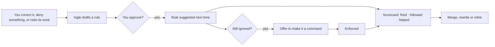

# Roadmap

Where Ingle is going, and why. This is a direction, not a promise: items move as we learn what helps.
For what's already built and its known limits, see [features.md](features.md) and
[weaknesses-and-mitigations.md](weaknesses-and-mitigations.md).

## The idea in one line

**Models are replaceable engines. Ingle is the part that knows you.**

A small local model will never out-think a frontier model. It can, however, be given what it's missing: knowledge of
your projects, your tools, your habits and its own past mistakes, kept as readable files in `~/.ingle`, enforced where
it matters, and carried over when you switch to a better model next year. No retraining, and nothing leaves your
machines.

## Principles

Every item below has to respect these.

1. **Local first.** Everything works offline on your own hardware. Network use stays opt-in and listed in
   [../PRIVACY.md](../PRIVACY.md).
2. **Knowledge lives in files, not in weights.** Plain Markdown and JSON in `~/.ingle` that you can read, edit, back
   up, share and delete. Any model can use it; no model owns it.
3. **Curate, don't accumulate.** Small models get worse with more context. Every learned thing must earn its place
   and is merged or retired when it stops helping.
4. **Enforce what matters.** Advice is suggested; obligations are checked by the harness ([commands.md](commands.md)).
5. **You stay in charge.** Anything Ingle learns or schedules is visible, reviewable and reversible. Approvals are
   never bypassed.
6. **Measure it.** A claim that Ingle makes models better needs numbers behind it.
7. **Small and native.** No Electron, no runtime dependencies in the extension, prompts kept short.

## Phases at a glance

| Phase | Theme | Headline items |
|---|---|---|
| **1. Preview → usable** | Anyone can install it and trust it | Benchmark, signed download, first-run model picker, unify the two apps |
| **2. Learning loop** | It gets better the more you use it | Rules drafted from corrections, scorecards, worked examples, model playbooks, knowledge packs |
| **3. Projects and schedules** | It organises your work, not just chats | Projects, scheduled tasks, shared chat storage, checkpoints |
| **4. Everywhere** | The same Ingle on every machine | Windows/Linux extension, Ingle Knowledge Portal, web UI, encryption |
| **5. Open design** | Others can build on it | Open design system, plugin/skill sharing, contributor tooling |

Phases overlap; the order is about dependencies, not dates.

---

## Phase 1 — Preview → usable

The two biggest things holding Ingle back are install friction and the lack of evidence.

### Benchmark (first, before the learning loop)
A fixed set of 15–25 realistic tasks, scripted so anyone can run them: fix a failing test, add an endpoint, rename
across files, follow a command, use an MCP server, summarise a PDF, answer from memory. Each run records success,
steps, nudges, approvals needed and tokens.
- Run the same model **with and without** Ingle's compensations (tool filtering, commands, guards, tuning, repo map).
- Compare quantisations (e.g. IQ4_XS vs Q4_K_XL) and models.
- Publish results in the README. Re-run before every release so a change that makes things worse is caught.

Why first: phase 2 claims "it gets better with use". Without a baseline there's no way to tell help from harm.

### Install
- **Developer ID signing and notarisation** for the Mac app, then a downloadable `.dmg` and **app self-update**.
- **First-run model picker** that reads the Mac's memory and suggests models that fit (8, 16, 24, 32, 64 GB+),
  with download sizes and a one-line "good at" for each.
- **Download the engine on first launch** as an option, so the app download is a few MB.
- Publish the extension to the **VS Code Marketplace** and **Open VSX** (Cursor, Windsurf, VSCodium).

### Reliability
- Check and, where needed, override Ollama's tool-call parser for Qwen-family models (`PARSER`/`RENDERER`).
- An in-app **tool-call self-test** per model ("can this model call tools reliably on this Mac?").
- Warn when a user's own Ollama is older than a known-vulnerable version.
- Optional **bring-your-own API key** fallback for the hardest jobs, off by default and clearly labelled as leaving
  the machine.

### Consistency between the apps
Unify the differences listed in [commands.md](commands.md) (`when: always`, `never_use` with `mcp:`, missing
required tools, nudges, `command_create`). Long term, move shared behaviour
into one spec with tests both apps run against.

### Tests
A first automated test suite: command parsing and enforcement, tool selection, compaction, frontmatter, matching.
Started: the VS Code extension has `npm test` (node:test) for commands, tool selection, frontmatter, edit matching and
matching. Still to do: compaction, and tests for the Mac app.

---

## Phase 2 — The learning loop

Rules and commands are how Ingle is tuned today, but they're written by hand, so Ingle only improves as fast as
someone writes them. Phase 2 turns them into a loop:

### Learn from outcomes, not opinions
The harness knows what really happened: which tool calls succeeded, which command passed, what you denied, when you
said "no, not like that", when you edited its output afterwards. Lessons come from those signals, never from the
model grading itself.

### Items
- **"Save as a rule?"** — after a correction, Ingle offers a drafted rule. The same lesson ignored again → offer a
  command.
- **Scorecards** for every rule, command and skill: times matched, times used, nudges needed, and whether the run
  finished without you stepping in. Shown in Settings, with prompts like *"ui-components fired 12 times and was ignored
  9"* or *"lint-after-edits hasn't fired in 30 days"*.
- **Worked examples** — short records of runs that succeeded ("added an endpoint: searched X, edited Y, ran Z,
  tests passed"). The closest one or two are offered as examples; small models copy examples far better than they
  follow instructions.
- **Model playbooks** — a short, per-model list of what *that* model tends to get wrong ("reads before editing",
  "forgets to run tests"), only shown to that model.
- **Knowledge packs** — keep models current after their training cutoff. For example, a TypeScript pack built from
  release notes and docs (new syntax, deprecated APIs, compiler options) that's suggested when you work in a project
  using that version. Built with the existing research tools, versioned, and refreshable.
- **Learning about you** — how you like code written, your stack, naming, review style, the people and projects
  around you, saved to memory with dates so stale facts can be checked ("still on Node 20?").
- **"What Ingle learned"** — one review screen for everything learned: approve, edit, merge, delete.

### Guard rails
- A strict context budget for learned material; nothing is pasted in full unless a command requires it.
- Lessons are edited in place, not repeatedly rewritten, so specifics aren't summarised away.
- Anything learned can be traced to the run it came from.
- The benchmark is re-run with learning on and off.

---

## Phase 3 — Projects and schedules

### Projects
A project groups everything about one piece of work: chats, coding sessions, files and folders, its own rules,
skills, commands and memory, and an optional repo. The assistant knows which project it's in, so it suggests the right
things and doesn't mix up two codebases. VS Code workspaces map to projects automatically (keyed by git remote).

### Scheduled tasks
Things that run on their own, locally, with results waiting for you:
- a morning summary of your projects, open TODOs and anything that changed;
- re-running research reports weekly and noting what's new;
- refreshing knowledge packs when a new TypeScript (or any tracked tool) version ships;
- checking a repo's tests nightly;
- reminders tied to a project.

Rules for schedules: each one is a file in `~/.ingle/schedules/`, visible and pausable; it runs only while the Mac is
awake and the engine is available; it can't do anything that needs approval without you (approval-needing steps
wait as a notification); power-aware, so it won't run a 30B model on battery unless allowed.

### Shared chat storage
Move chats from app-specific storage to `~/.ingle/chats/` (normal chats) and `~/.ingle/coding/<project>/`
(coding sessions, kept separate from everyday chats). Both apps read the same history, and it's ready for syncing.

### Checkpoints
Snapshot files before the assistant changes them, so a whole agent run can be undone in one step.

---

## Phase 4 — Everywhere

### Windows and Linux
The VS Code extension first, since it's TypeScript with no runtime dependencies. Replace the macOS-only pieces
(`sips`, `textutil`, PDFKit, Vision OCR, `/bin/zsh`) with cross-platform ones (pdf.js, mammoth, exceljs,
tesseract.js; PowerShell or bash), and find the engine via `OLLAMA_HOST`. A native desktop app on those platforms
only if the extension shows demand.

### Ingle Knowledge Portal
A small self-hosted hub on your own network (a Docker container on a home server or NAS) that keeps every device's
Ingle in sync.

- **Discovery:** devices find the Portal with mDNS/Bonjour when they're on the same network.
- **Pairing:** a one-time code links each device; no accounts, no cloud.
- **Sync:** when a device comes back into range after being away, it backs up and merges everything: memory, rules,
  skills, commands, research, knowledge packs, chats and coding sessions (coding kept separate, per project).
- **Versioned storage:** every change is kept, so anything can be restored.
- **Conflicts:** files merge line by line where possible; true conflicts are kept side by side for you to choose.
- **Web UI:** read, search and edit everything Ingle knows from any browser on your network; ask questions
  across all of it; restore old versions.
- Optionally runs its own engine, so lighter devices can use a bigger model on the Portal.

### Encryption
Once `~/.ingle` knows how you work and who's around you, it's the most sensitive file on your machine.
Encrypt it at rest (Keychain-held key on the Mac), and make Portal sync **end-to-end encrypted** so the Portal stores
only ciphertext unless you choose otherwise.

---

## Phase 5 — Open design and community

### Open design system
Publish Ingle's design as an open design system that anyone can reuse and improve: the ember palette, type, spacing,
components (pills, approval card, chips, context meter, tool rows), icons, and the rules behind them, with matching
SwiftUI and webview CSS implementations. Contributions to the look go through the design system first, so the Mac app,
VS Code and the Portal web UI stay consistent.

### Sharing
- Share and install skills, rules, commands and knowledge packs as simple bundles (a folder or a git repo).
- A curated community index, with clear review before anything that runs commands is installed.

### Contributor tooling
The benchmark, the test suite and CI that builds both apps, so contributions can be checked automatically.

---

## Ideas we're considering

Not committed; open an issue if you want to argue for one.

- Voice input and spoken replies, fully local.
- Rider/JetBrains plugin using the existing editor bridge.
- An iPhone companion that talks to the Portal.
- Semantic `when` matching for commands (more forgiving, less predictable).
- Multi-agent jobs: a planner model with a fast worker model.

## How to help

Pick an item, open an issue to say you're on it, and follow [../CONTRIBUTING.md](../CONTRIBUTING.md). The most
useful contributions right now: benchmark tasks, tests, and the cross-platform replacements in phase 4.
