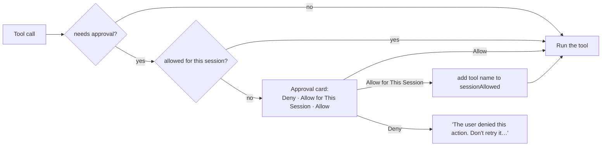

# Terminal and Mac control

Ingle's assistants can act on your Mac, but only in two clearly separated levels, and every change goes through
an approval card first.

| Level | Tools | When it's available | Asks first? |
|---|---|---|---|
| **1. Terminal** | `list_files`, `read_file`, `write_file`, `run_command` (VS Code also `find_files`, `search_code`, `get_problems`, `edit_file`, `read_document`, `view_image`, `open_url`) | **Always**, in every chat | Writes, edits and commands: always. Reads: only outside your workspace folders. |
| **2. Mac control** (Mac app only) | `open`, `applescript`, `screenshot` | Only when the **Mac** button in that chat's message bar is on | Every action |

Code: [`../Sources/Ingle/Tools.swift`](../Sources/Ingle/Tools.swift) (`MacTools.definitions`,
`MacTools.controlDefinitions`, `MacTools.needsApproval`, `MacTools.run`),
[`../Sources/Ingle/ChatStore.swift`](../Sources/Ingle/ChatStore.swift) (`runTool`, `requestApproval`, `resolve`),
[`../Extensions/vscode/src/tools/files.ts`](../Extensions/vscode/src/tools/files.ts),
[`command.ts`](../Extensions/vscode/src/tools/command.ts), [`paths.ts`](../Extensions/vscode/src/tools/paths.ts).

## Level 1: Terminal

Terminal is for files, code, git, builds, tests and scripts. It's always offered because coding help without it
is mostly guesswork, and every command or write still needs your approval.

### Reading

- **Mac:** `list_files` (hidden files skipped, first 500 entries) and `read_file` (text up to 100,000 characters;
  PDFs, Word, RTF, Excel and Pages as text via `DocumentReader`; images are attached so the model can see them).
  Paths can use `~`.
- **VS Code:** `read_file` (with line numbers and optional `start_line`/`end_line`), `list_files`, `find_files`
  (glob), `search_code` (case-insensitive text, up to 100 hits, skips `node_modules`, `.git`, `dist`, `build`…),
  `get_problems` (VS Code's diagnostics), `read_document`, `view_image`, `repo_map`.
- **Free reads:** inside your **workspace folders** no approval is needed.
  - Mac: Settings → Mac Access → Workspace folders (default `~/Projects`) with **Read files here without asking**
    (`Prefs.autoReadWorkspace`). Outside them, every read asks.
  - VS Code: the open folders, plus the Mac app's workspace folders, plus `~/.ingle/skills`, `~/.ingle/rules` and
    (if enabled) `~/.claude/skills`. Symlinks are resolved so a link can't smuggle a path outside
    (`isReadableFreely`). Outside them, the card says "Wants to read a file outside the project".

### Changing things

- **`write_file`** creates or overwrites a file (folders are created). Mac writes directly; VS Code shows the new
  content and, for existing files, a diff, then applies it through a `WorkspaceEdit` so **Undo** works.
- **`edit_file`** (VS Code) replaces one exact piece of text; see
  [vscode-extension.md](vscode-extension.md#editing-files-safely).
- **`run_command`** runs `zsh -lc "<command>"` (a login shell, so your `PATH` from Terminal applies) with a
  **2-minute timeout**; output (stdout and stderr together) is capped at 20,000 characters.
  - Mac: optional `cwd` anywhere; runs detached from the UI.
  - VS Code: runs in the project folder; `cwd` must be **inside the project**. Output has ANSI colours stripped,
    `TERM=dumb`, `NO_COLOR=1`, pagers off, and keeps the start and mostly the end. **Stop** kills the whole process
    group.
- **`open_url`** (VS Code) opens an http(s) link in your browser after approval.

The prompt also tells models: look before you act, one tool at a time, never delete files, use `sudo` or change
system settings unless clearly asked, and don't use `osascript` or `open` from Terminal to control apps (that's
Mac control). These are instructions, not enforcement — but any such command would still need your approval.

## Level 2: Mac control

Switch on **Mac** in the message bar (next to Think and Web) to let the assistant drive apps and see your screen in
**that chat**. It's off by default for every new chat (`Conversation.macAccess`). With it on, the prompt gains
`MacTools.controlPrompt` (prefer an app's own AppleScript over clicking; take a screenshot to check; never enter
passwords, buy anything, send messages or delete things unless clearly asked).

| Tool | What it does | How |
|---|---|---|
| `open` | Opens an app, file, folder or URL | `open -a 'App'` for names, `open '<path or URL>'` otherwise (quoted; `~` expanded) |
| `applescript` | Runs an AppleScript, e.g. `tell application "Music" to play`, or System Events for clicks, menus and typing | Written to a temporary `.applescript` file and run with `/usr/bin/osascript`, so quotes need no escaping |
| `screenshot` | Captures the screen so the model can see it | `/usr/sbin/screencapture -x` to a temporary PNG, converted to JPEG and attached; non-vision models get the OCR text |

If the model calls one of these while the Mac button is off, `ChatStore.runTool` refuses and tells it to ask you
to switch it on. The tools aren't even offered in that case.

### macOS permissions

macOS asks for these the first time, per app. They're tied to the app's **bundle identifier**, so keep using the
same one (`INGLE_BUNDLE_ID` in `local.env`) or macOS treats a rebuild as a new app.

| Permission | Needed for | Where to grant it |
|---|---|---|
| **Automation** (Apple Events) | `applescript` and `open` controlling another app. macOS prompts once per target app, showing `NSAppleEventsUsageDescription` ("Ingle runs AppleScript and opens apps only when you approve it in a chat"). | System Settings → Privacy & Security → Automation → Ingle |
| **Accessibility** | AppleScript that uses **System Events** to click, choose menus or type; also **Follow Rider** | System Settings → Privacy & Security → Accessibility → Ingle (Settings → Extensions has **Grant Accessibility Permission…**) |
| **Screen & System Audio Recording** | `screenshot`. Without it, `screencapture` produces nothing useful and the tool says how to fix it. | System Settings → Privacy & Security → Screen & System Audio Recording → Ingle |
| **Files and Folders** (Desktop, Documents, Downloads) | Reading files there (`NSDesktopFolderUsageDescription` etc.) | Prompted on first access |

Because Ingle is ad-hoc signed during the preview, macOS may forget these grants after a rebuild; see
[troubleshooting.md](troubleshooting.md#macos-permissions-applescript-screenshots-rider).

## Approvals

**What needs approval** (`MacTools.needsApproval`; in VS Code each tool calls `ctx.requestApproval` itself):

| Never asks | Asks only sometimes | Always asks |
|---|---|---|
| `use_skill`, `use_rule`, `ingle_help`, `mcp_tools`, `web_search`, `web_fetch`, `memory_search`, `memory_read`, `chat_*`, `report_*`, `delegate`, VS Code's `find_files`, `search_code`, `get_problems`, `repo_map` | `list_files`, `read_file` (and VS Code `read_document`, `view_image`): outside workspace folders. `memory_save`, `memory_rewrite`, `memory_forget`: if **Ask before saving** is on. | `write_file`, `edit_file`, `run_command`, `open_url`, `open`, `applescript`, `screenshot`, `mcp_call`, `skill_create`, `rule_create`, `command_create`, any other tool |

**The card** shows what will happen in plain words ("Run a command", "Wants to edit a file") and the exact detail —
the command (with `cd <cwd> &&`), the path, the AppleScript, the MCP arguments as JSON, the command file that would
be created. In VS Code, edits and overwrites show a unified diff and a **View Diff** button that opens VS Code's diff
editor (see [vscode-extension.md](vscode-extension.md#editing-files-safely)). Only one card is shown at a time;
**Stop** denies it.

**Deny** returns a message telling the model not to retry and to ask you instead. **Allow** runs it once.

### Allow for This Session

**Allow for This Session** adds the **tool name** to a set of session allowances, and from then on that kind of
action runs without asking:

- **Mac:** `ChatStore.sessionAllowed` — for **every chat** in the app, until Ingle quits. A small
  **"N allowed"** badge in the message bar lists them (hover) and clears them (click), via
  `forgetSessionApprovals()`.
- **VS Code:** `EngineShared.sessionAllowed` — shared by **every Ingle tab**, until VS Code closes (or the extension
  is reloaded). Clear it with the command **Ingle: Ask Before Every Action Again** (`ingle.forgetApprovals`).

It is deliberately coarse: allowing `run_command` allows *any* command, and allowing `read_file` for an
out-of-project read allows all later out-of-project reads. Nothing is saved to disk. Helpers (sub-agents) can't
write anything, so they never use these allowances for changes.

## Trade-offs

| We chose | We gave up | Why |
|---|---|---|
| **Terminal always on**, approvals per action | A per-chat switch for files and commands | Coding help needs to read and run things; an extra switch was one more thing to forget. The approval card is the real safety boundary, and reads are free only inside folders you chose. |
| **Mac control behind a per-chat switch** | Convenience | AppleScript and screenshots reach every app and everything on screen — mail, messages, banking — so they need a deliberate, visible opt-in per chat on top of approvals. |
| **Session-wide allowances by tool name** | Fine-grained rules (per command prefix, per folder, per chat) | Approving every `npm test` in a long task is tiring, and approval fatigue makes people click Allow without reading. A coarse, clearly-badged, memory-only allowance that you can clear in one click is easy to understand. The risk is real: after allowing `run_command`, a confused model can run anything. A per-command allow-list is a candidate for the [roadmap](roadmap.md). |
| `zsh -lc` login shell | A clean, predictable environment | Your Terminal `PATH` (Homebrew, nvm, pyenv) just works; but login scripts run every time and can be slow or noisy. |
| 2-minute command timeout | Long builds and dev servers | Keeps the loop responsive; a model can't leave a server running in the background. Long jobs should be run by you in Terminal. |
| AppleScript via a temp file and `osascript` | Running scripts in-process with `NSAppleScript` | No escaping bugs, the same behaviour you'd get in Script Editor, and permissions are attributed to Ingle. |
| VS Code limits `run_command`'s `cwd` to the project; Mac doesn't | Consistency | VS Code is project-scoped by nature; the Mac app is a general assistant whose workspace can be anywhere. |
| Instructions (not enforcement) against `osascript`/`open` in Terminal | A hard block | A command filter is easy to bypass and gives false confidence; the approval card shows the exact command either way. |
