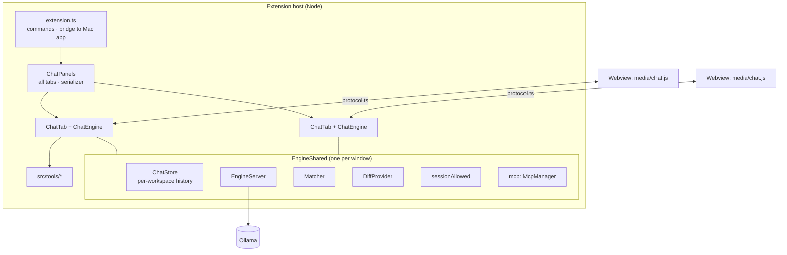

# Ingle for VS Code

Ingle's coding chat, as editor tabs in VS Code (and forks such as Cursor). It talks to the Ollama engine directly,
so **the Mac app doesn't need to be open**; if no engine answers, it starts the one bundled inside `Ingle.app`. It
shares `~/.ingle` with the Mac app: assistants, rules, skills, commands, memory, research and MCP servers.

- Code: [`../Extensions/vscode/`](../Extensions/vscode/) — TypeScript (strict), **no runtime npm dependencies**
  (Node and VS Code APIs only), a plain-JavaScript webview.
- Manifest: [`package.json`](../Extensions/vscode/package.json) — version `0.2.0`, `preview: true`, VS Code
  `^1.85.0`, activates on start-up and when a saved Ingle tab is restored.

## Architecture

### `EngineShared` vs per-tab `ChatEngine`

[`src/engine/chatEngine.ts`](../Extensions/vscode/src/engine/chatEngine.ts):

| `EngineShared` — one for all tabs | `ChatEngine` — one per tab |
|---|---|
| `store`: the chat history for this workspace | `currentId`: which chat this tab shows |
| `server`: finds or starts the engine; broadcasts its state to every tab | `generating`: this tab's running request and its `AbortController` |
| `matcher`: embedding cache for rules/skills/memory/reports | `pending`: this tab's approval card |
| `diff`: the `ingle-diff:` virtual documents | `activity`, editor tracking (`lastEditor`), context chip |
| `visionCache` per model | the agent loop: `send`, `generate`, `runLoop`, `runToolCall`, `runSubAgent`, `compact` |
| `sessionAllowed`: "Allow for this session", for every tab | slash commands, `/mcp`, attachments, insert/apply code |
| `engines`: every live `ChatEngine`, so a change in one tab refreshes the others' history (`chatsChanged`) | |

Each tab can run its own request at the same time as another tab; they share the one model.

### Tabs: `ChatPanels` and `ChatTab`

[`src/ui/chatView.ts`](../Extensions/vscode/src/ui/chatView.ts):

- The **Ingle icon** in the editor title bar (`ingle.newTab`, `editor/title` menu, `resources/ingle-ember.svg`)
  always opens **another** tab with a new chat. The first opens beside your code (`ingle.openBeside`); later ones
  join the column of the last Ingle tab.
- `ChatPanels.reveal()` focuses the last-used tab (or opens one); editor commands such as **Ask Ingle About This**
  go there.
- **↗ Pop out** (`ingle.popOut`) runs `workbench.action.moveEditorToNewWindow`.
- **Restore after restart:** `ChatPanels` is a `WebviewPanelSerializer`; the webview stores `chatId` in its state,
  and `deserializeWebviewPanel` reopens each tab on its chat.
- **Tab title = chat title.** `ChatTab.post` updates `panel.title` from `init`/`chats` messages ("Ingle" for a new
  chat). After the first reply, `summariseTitle` asks the model for a 2–6 word title (`think: false`,
  `num_ctx 4096`, 30 s timeout); the first line of your message is used until then.
- Webviews use `retainContextWhenHidden`, a strict CSP (`default-src 'none'`, nonce'd script, only `media/` as a
  resource root) and messages that arrive before the page says `ready` are queued (prefill, approval, status).

### Chat storage

[`src/engine/chatStore.ts`](../Extensions/vscode/src/engine/chatStore.ts): per workspace, in VS Code's global
storage, `chats-<first 16 hex of sha1(workspace path)>.json`. The 50 most recently updated non-empty chats are kept;
saves are atomic (write then rename) and coalesced while streaming (`saveSoon`, 1.5 s). Stored messages include the
raw `tool_calls` and base64 images needed to replay history to Ollama, plus hidden extras (extracted document text,
OCR, nudges) that the UI never sees (`forUI`).

## The webview protocol

[`src/shared/protocol.ts`](../Extensions/vscode/src/shared/protocol.ts) is the contract between the extension host
and [`media/chat.js`](../Extensions/vscode/media/chat.js). **Both sides must match.**

### Extension → webview (`ToWebview`)

| Type | Payload | Purpose |
|---|---|---|
| `init` | `state: UIState` | Everything to draw the tab: assistants, current assistant, Think/Web/context toggles, chat list, messages, editor context, engine state, vision, context usage, slash items, version |
| `messageAdd` | `message` | Append a message (user, assistant, tool row) |
| `messageDelta` | `id`, `content?`, `thinking?` | Stream text into a message |
| `messageUpdate` | `message` | Replace a whole message (final stats, tool output, chips) |
| `status` | `streaming`, `activity` | Spinner and activity line ("Running a command…") |
| `approval` | `approval: ApprovalRequest` | Show the approval card |
| `approvalClear` | — | Remove it |
| `context` | `context?` | Editor context chip (project, file, language, selection, problems) |
| `engine` | `state`, `text` | Engine starting / ready / offline |
| `chats` | `chats`, `chatId` | Refreshed history list |
| `prefill` | `text` | Put text in the message box |
| `attachments` | `attachments` | Add files picked with the paperclip |
| `contextUsage` | `used`, `limit` | Context meter |
| `slashItems` | `items` | Slash menu after `/skill-reload` |
| `mcp` | `servers: MCPServerInfo[]` | Open the `/mcp` dialog |
| `notice` | `text` | Short note under the composer (fades after ~4 s) |

### Webview → extension (`FromWebview`)

| Type | Payload | Purpose |
|---|---|---|
| `ready` | — | The page is listening; the host replies with `init` |
| `send` | `text`, `attachments?` | Send a message |
| `compact` | — | Compact chat |
| `slash` | `name` | A command from the `/` menu |
| `mcpRefresh` / `openMcpConfig` | — | `/mcp` dialog buttons |
| `pickFiles` | — | Paperclip: show the file picker |
| `stop` | — | Stop |
| `newChat` / `openChat` / `deleteChat` | `id` | History |
| `setAssistant` | `id` | `daily` or `hard` |
| `toggle` | `key: think \| web \| useContext`, `value` | Message-bar switches |
| `approve` | `id`, `decision: allow \| deny \| always` | Approval card |
| `showDiff` | `id` | **View Diff** on an approval |
| `insertCode` / `applyCode` | `code`, `language?` | Code block buttons |
| `copy` | `text` | Copy to the clipboard |
| `regenerate` | — | Regenerate the last reply |
| `startEngine` | — | Start the engine now |
| `openSettings` | — | Open `~/.ingle` |

Key shapes: `ChatMessage` (with `tool`, `usedContext`, `stats`, `thoughtSeconds`, `attachments`, `compaction`),
`ApprovalRequest` (`kind`: command, write, edit, open, mcp, memory, skill, rule, read, ssh; `title`, `detail`,
`preview`, `canShowDiff`), `UIState`, `MCPServerInfo`.

**The webview** is plain JavaScript with no frameworks or CDNs: a tiny `h()` element builder, a safe Markdown
renderer that escapes everything before adding markup, syntax colouring, the composer (paste, drag and drop, the
paperclip; hold Shift when dropping from Finder, or VS Code opens the file instead), slash menu, context meter
(ring + percentage, click for details and **Compact chat**), approval card, `/mcp` modal, history menu, and an
ARIA live region for announcements.

## Tools

All tools implement `ToolDef` ([`src/tools/types.ts`](../Extensions/vscode/src/tools/types.ts)): `name`,
`description`, JSON-schema `parameters`, `readOnly` (helpers may use it), `available(ctx)`, `describe(args)` (the
row in the chat) and `run(args, ctx)`, which **asks for approval itself** through `ctx.requestApproval` and never
throws. The list is in [`src/tools/index.ts`](../Extensions/vscode/src/tools/index.ts); the engine adds `delegate`.

| Tool | File | Read-only | Approval |
|---|---|---|---|
| `repo_map` | [`repomap.ts`](../Extensions/vscode/src/tools/repomap.ts) | yes | no |
| `read_file`, `list_files` | [`files.ts`](../Extensions/vscode/src/tools/files.ts) | yes | outside the project |
| `find_files`, `search_code`, `get_problems` | `files.ts` | yes | no |
| `edit_file`, `write_file` | `files.ts` | no | always, with diff |
| `read_document`, `view_image` | [`documents.ts`](../Extensions/vscode/src/tools/documents.ts) | yes | outside the project |
| `run_command`, `open_url` | [`command.ts`](../Extensions/vscode/src/tools/command.ts) | no | always |
| `ssh_command` | [`ssh.ts`](../Extensions/vscode/src/tools/ssh.ts) | no | always (SSH on only) |
| `web_search`, `web_fetch` | [`web.ts`](../Extensions/vscode/src/tools/web.ts) | yes | no (Web on only) |
| `memory_search`, `memory_read`, `memory_save`, `memory_rewrite`, `memory_forget` | [`memory.ts`](../Extensions/vscode/src/tools/memory.ts) | search/read | saves if "ask first" |
| `use_skill`, `use_rule`, `report_search`, `report_read`, `report_save`, `skill_create`, `rule_create` | [`knowledge.ts`](../Extensions/vscode/src/tools/knowledge.ts) | reads | creates always |
| `command_create` | [`commands.ts`](../Extensions/vscode/src/tools/commands.ts) | no | always |
| `mcp_tools`, `mcp_call` | [`mcp.ts`](../Extensions/vscode/src/tools/mcp.ts) | `mcp_tools` | `mcp_call` always |
| `delegate` | `chatEngine.ts` | — | no |

Per-turn selection and the guards are described in [agent-loop.md](agent-loop.md#3-tool-selection).

### SSH access

`ssh_command { host, command, cwd? }` runs a command on one of **your own** servers. It's off by default and follows
the same design as the Mac app:

- **Hosts come from you, never the model.** A host is usable only if it's a plain `Host` alias in `~/.ssh/config`
  (wildcard and `!` patterns are skipped, `Match` blocks are ignored, `Include` is followed up to 5 levels) **and**
  switched on in Ingle. Anything else, including a raw `user@1.2.3.4`, is refused with "That host isn't set up for
  Ingle…".
- **Where "switched on" comes from:** the `ssh` block the Mac app writes to `~/.ingle/settings.json`
  (`{ "enabled": false, "hosts": [] }` by default), overridden by `ingle.ssh.enabled` / `ingle.ssh.hosts` in your
  **user** settings when you set them. Workspace settings are ignored, so a project can't switch SSH on.
- **Runs the system client** with an argument array, no local shell: `/usr/bin/ssh -o BatchMode=yes -o
  ConnectTimeout=10 -o StrictHostKeyChecking=yes -T <alias> -- <command>`, with `cd '<cwd>' &&` added (shell-quoted)
  when `cwd` is given. Keys or ssh-agent only; Ingle never asks for or types passwords. An unknown or changed host key
  fails, and the result tells you to connect once in Terminal first.
- **Same limits as `run_command`** (`runProcess` in `command.ts`): 2-minute timeout, output trimmed, ANSI removed,
  stops on Stop.
- **Always asks.** The card's title names the host ("Wants to run a command on homelab"); "Allow for this session"
  covers the same host, folder and exact command only.
- **Offered only when relevant:** when SSH is on and the message mentions `ssh`, `server`, `remote` or an enabled
  host name (`wantsSSH`), or a Command's `must_use: ssh_command` forces it. Helpers never get it. The prompt lists
  the enabled host names (`sshFact`).

The pure parts (config parsing, host checks, quoting, scope, wanting) are in
[`sshConfig.ts`](../Extensions/vscode/src/tools/sshConfig.ts) and tested in `test/ssh.test.ts`.

### Editing files safely

- **`edit_file(path, old_text, new_text)`** uses `planEdit`
  ([`editmatch.ts`](../Extensions/vscode/src/tools/editmatch.ts)): an exact unique match first; then exact after
  converting to the file's line endings; then a line-by-line match that ignores trailing whitespace and `\r` (the
  first line may start mid-line, the last may end mid-line). More than one match → "appears N times, include more
  lines". No match → the **closest lines** (bigram similarity, with line numbers) so the model can correct itself.
  `new_text` is converted to the file's line endings.
- **Approval** shows a unified diff ([`tools/diff.ts`](../Extensions/vscode/src/tools/diff.ts)) and a **View Diff**
  button, which opens VS Code's diff editor between the current text (including unsaved changes) and the proposal,
  using in-memory `ingle-diff:` documents ([`engine/diff.ts`](../Extensions/vscode/src/engine/diff.ts)).
- **Applying** (`applyText`): if the document changed while you were deciding, the edit is refused ("changed while
  waiting for approval"); otherwise only the changed middle is replaced through a `WorkspaceEdit` (so **Undo** works
  and cursors elsewhere stay put) and the file is saved.
- **`write_file`** shows the new content (and a diff when overwriting); new files are written to disk with folders
  created.

### Repo map

[`src/tools/repomap.ts`](../Extensions/vscode/src/tools/repomap.ts) — like Aider's repo map, without tree-sitter.

- **Indexing:** up to 4,000 code files from `findFiles` (skipping `node_modules`, `.git`, build folders, minified
  files, `.d.ts`, vendor and virtual-env folders); files over 300 KB get no symbols. Symbols come from
  per-language regular expressions (TypeScript/JavaScript/Vue/Svelte exports, classes, public methods, functions,
  Express routes; Swift types and non-private functions; C#, Python, Go, Rust, Kotlin/Java, Ruby, PHP, Dart and
  others) and relative imports. Results are cached by modification time.
- **Ranking for each request:** active file +100, open tabs +40, changed in `git status` +30, imported by the active
  file +25, imports the active file +20, each query word in the path +15 or in the symbols +8, entry-point names +5,
  minus folder depth, minus 5 for no symbols.
- **Output:** "N code files. Folders: …", then the top files with up to 14 symbols each, until the budget, then "…and
  N more files". Every request gets a map within `min(6000, 0.4 × context)` characters when a project is open and the
  context chip is on; the `repo_map(focus, folder)` tool returns up to 16,000 characters.

### Attachments, documents and images

`prepareAttachments` in `chatEngine.ts` and [`documents.ts`](../Extensions/vscode/src/tools/documents.ts):

- Paste, drag and drop (webview sends base64, ≤ 20 MB) or the paperclip (the host sends paths).
- **Documents** become text that only the model sees (`extraContext`): PDFs via a JXA script using PDFKit, Word/RTF
  via `textutil`, iWork via `mdls`/the preview, `.xlsx` via `unzip` and a small XML reader, `.pptx` via `unzip`,
  text files directly.
- **Images** are converted with `sips` to a 1,600 px JPEG plus a 256 px thumbnail; vision models get the image,
  others get OCR text from Vision via JXA.
- These helpers use macOS's built-in tools. On other platforms the extension says "This needs macOS" for PDFs,
  Word, OCR and HEIC (plain text, `.docx` via `unzip`, `.xlsx` and `.pptx` still work). See
  [weaknesses-and-mitigations.md](weaknesses-and-mitigations.md#4-mac-only-reach).

### Code actions

Code blocks in replies have **Copy**, **Insert** (at the cursor in the last-used editor) and **Apply**: replace the
selection if there is one, otherwise show a whole-file diff and ask "Replace all of X with Ingle's code?" before
applying it as one edit.

### MCP

[`src/tools/mcp.ts`](../Extensions/vscode/src/tools/mcp.ts) is a small stdio MCP client shared by all tabs:

- Servers come from the same three configs as the Mac app (`mcpServers()` in
  [`stores.ts`](../Extensions/vscode/src/tools/stores.ts)); servers switched off in the Mac app (`mcpDisabled`) are
  skipped.
- Started **lazily** on first use, **directly** (not through a shell), in the workspace folder, with `PATH` extended
  by `/opt/homebrew/bin`, `/usr/local/bin` and `~/.local/bin` (GUI-launched editors often miss them).
- JSON-RPC 2.0 over newline-delimited stdio, protocol `2025-06-18`, `tools/list` with pagination, 90 s for the first
  start (`npx -y` downloads), 30 s per request, results capped at 20,000 characters.
- A server that crashes is restarted once; after a second crash it stays stopped until **Reload** in `/mcp`.
- The `/mcp` dialog shows servers this window has connected, otherwise the Mac app's live status from
  `settings.json` ("Connected in the Ingle app — VS Code starts its own when a chat uses it").
- `mcp_call` checks the server and tool exist **before** asking you, then shows the arguments as JSON on the card.

## Commands and keybindings

| Command | Title | Where |
|---|---|---|
| `ingle.newTab` | New Ingle Chat Tab | Ingle icon in the editor title bar |
| `ingle.focus` | Ingle: Open Chat | ⌘⌥L |
| `ingle.popOut` | Pop Out Chat into a New Window | ↗ in the title bar of an Ingle tab |
| `ingle.newChat` | Ingle: New Chat | |
| `ingle.askSelection` | Ask Ingle About This | ⌘⌥I in an editor; right-click with a selection |
| `ingle.explainProblem` | Ask Ingle to Explain This Problem | right-click |
| `ingle.fixProblem` | Ask Ingle to Fix This Problem | Command Palette |
| `ingle.openHome` | Open Ingle Folder (rules, skills, memory) | |
| `ingle.forgetApprovals` | Ask Before Every Action Again | clears session allowances |
| `ingle.terms`, `ingle.privacy`, `ingle.about` | Terms of Use, Privacy Policy, About Ingle | open the bundled legal files |

**Explain/Fix This Problem** picks the diagnostic on (or nearest to) the cursor line and sends it with 20 lines either
side. **Ask Ingle About This** prefills a new chat with the selection (or the lines around the cursor).

## Settings

| Setting | Default | Meaning |
|---|---|---|
| `ingle.shareWithApp` | `true` | Tell the Mac app (if open) which project and file you're in |
| `ingle.port` | `47123` | The Mac app's bridge port |
| `ingle.shareSelection` | `true` | Include your selection in what the Mac app sees |
| `ingle.shareProblems` | `true` | Include errors and warnings in what the Mac app sees |
| `ingle.openBeside` | `true` | Open the first tab beside your code |
| `ingle.maxSteps` | `200` | Backstop for steps in one request; `0` = no limit |
| `ingle.ssh.enabled` | unset | Turn SSH access on or off (user settings only); unset follows the Mac app, which defaults to off |
| `ingle.ssh.hosts` | unset | `~/.ssh/config` host names assistants may use (user settings only); unset follows the Mac app |

Everything else (assistants, models, context lengths, web, memory, workspace folders, engine, SSH) comes from
`~/.ingle/settings.json`, written by the Mac app.

## Installing: `install.sh`

[`install.sh`](../Extensions/vscode/install.sh):

1. `npm install` (build tools only: TypeScript, `@vscode/vsce`, type definitions).
2. `npm run compile` (`tsc -p ./` into `out/`).
3. Copy `TERMS.md`, `PRIVACY.md`, `LICENSE.md`, `LICENSING.md` into `legal/` (and `LICENSE.md` beside
   `package.json`).
4. If `VSCODE_PUBLISHER` is set in `../../local.env`, temporarily rewrite the publisher in `package.json` (restored on
   exit) — keep it stable, or VS Code treats it as a new extension with empty history.
5. `vsce package` → `ingle.vsix`.
6. Uninstall the old *Ingle Bridge* extension if present, then `code --install-extension ingle.vsix --force`. Without
   the `code` command, install the VSIX from the Extensions view.

Then reload VS Code and click the orange Ingle icon at the top right of any open file.

## Remote workspaces

*Research note (November 2026). Nothing here is built yet.* This covers windows opened through **Remote-SSH**,
**Dev Containers** and **WSL**. In all three, VS Code runs two extension hosts: a local one on the Mac (the "UI" side)
and a remote one inside the server, container or WSL distro (the "workspace" side). Each extension runs in only one of
them, picked by `extensionKind` in `package.json`.

### Current behaviour

`package.json` has **no `extensionKind`**, and it has a `main` entry but no `browser` entry. VS Code then infers
`["workspace"]`, so the extension runs **on the remote machine**. The docs don't spell out this rule; it comes from
VS Code's own manifest handling (`deduceExtensionKind`): code with `main` → workspace. In practice:

- **Installed only on the Mac** (what `install.sh` does). In a remote window the Extensions view shows Ingle as
  needing *Install in SSH: ‹host›* and it doesn't activate. There's no Ingle icon and no chat.
- **Installed on the remote** (the user clicks that button, or copies the `.vsix` over). It activates on the remote,
  where almost everything Ingle depends on is missing:

| Dependency | Where the code looks | Result on the remote |
|---|---|---|
| Engine `http://localhost:11434` ([`engine/ollama.ts`](../Extensions/vscode/src/engine/ollama.ts), [`engine/server.ts`](../Extensions/vscode/src/engine/server.ts)) | `localhost` of the remote host | Nothing is listening. `enginePath` (a Mac path) doesn't exist, so `doStart` can't start it either → "offline". Ingle can't chat at all. |
| `~/.ingle` and `settings.json` ([`shared/settings.ts`](../Extensions/vscode/src/shared/settings.ts), [`tools/stores.ts`](../Extensions/vscode/src/tools/stores.ts)) | `os.homedir()` on the remote | Empty or missing. Defaults apply; no rules, skills, commands, memory, research or MCP servers. Memory written there is lost to the Mac. |
| Editor bridge `127.0.0.1:47123` ([`extension.ts`](../Extensions/vscode/src/extension.ts)) | `~/.ingle/bridge-token` and `127.0.0.1` on the remote | No token, so it quietly does nothing. The Mac app never hears about the project. |
| File tools ([`tools/files.ts`](../Extensions/vscode/src/tools/files.ts), [`tools/paths.ts`](../Extensions/vscode/src/tools/paths.ts), [`tools/repomap.ts`](../Extensions/vscode/src/tools/repomap.ts)) | Node `fs` with `uri.fsPath` | **Works**: the files are local to that host. |
| `run_command` ([`tools/command.ts`](../Extensions/vscode/src/tools/command.ts)) | `child_process.spawn` with `/bin/zsh -lc`, else `$SHELL`, else `/bin/sh` | **Works, and runs on the remote**, which is usually what the user wants. Falls back to `bash`/`sh` on Linux. |
| Documents and images ([`tools/documents.ts`](../Extensions/vscode/src/tools/documents.ts)) | `textutil`, `sips`, JXA (macOS only) | `IS_MAC` is false: Word/RTF/PDF/OCR say "needs macOS" and images aren't resized. DOCX/PPTX/XLSX still work if `unzip` is installed on the remote. |
| MCP servers ([`tools/mcp.ts`](../Extensions/vscode/src/tools/mcp.ts)) | Spawned on the remote from remote `~/.ingle/mcp.json` | No config, so no servers. |
| Companion fact ([`engine/prompt.ts`](../Extensions/vscode/src/engine/prompt.ts)) | `process.platform === 'darwin'` | Says "only Ingle for VS Code is available", which is wrong. |
| Chat history ([`engine/chatStore.ts`](../Extensions/vscode/src/engine/chatStore.ts)) | `globalStorageUri` on the remote | Separate from local chats; works. |
| `open_url` (`vscode.env.openExternal`) | Forwarded to the Mac by VS Code | Works. |

So today Ingle is either missing from remote windows or present but unable to reach its engine. The one thing that
works better remotely is that commands and file tools act on the remote machine.

**WSL** is a Windows feature, and the extension is Mac-only for now (see the
[roadmap](roadmap.md#windows-and-linux-for-the-extension)). The same split applies once a Windows build exists:
the engine and `~/.ingle` would be on Windows, the workspace in the distro. **Dev Containers** behave exactly like
Remote-SSH, with the container as the remote. **Codespaces / vscode.dev** use a web extension host, which needs a
`browser` entry we don't have, so they're out of scope.

### Recommended change

Run Ingle **on the Mac** (UI side), because the engine, `~/.ingle`, the Mac app and the macOS tools all live there.
Then reach the workspace through VS Code's APIs, which route to the remote for you. File by file:

1. **[`package.json`](../Extensions/vscode/package.json)**: add `"extensionKind": ["ui"]`. Not
   `["ui", "workspace"]`: falling back to the remote host would quietly bring back every problem above. Bump
   `engines.vscode` to `^1.93.0` for the stable terminal shell-integration API (step 4).
2. **Workspace paths → URIs.** In a remote window, workspace URIs have the `vscode-remote` scheme, and
   `uri.fsPath` is a remote path that Node `fs` on the Mac can't open. Keep the model-facing text as plain paths,
   but resolve them to `vscode.Uri`s:
   - [`tools/paths.ts`](../Extensions/vscode/src/tools/paths.ts): `baseFolder` returns the workspace folder's
     `Uri`; `resolvePath` returns a `Uri` built with `vscode.Uri.joinPath(folder.uri, rel)` (or
     `folder.uri.with({ path })` for absolute paths). `real`, `exists`, `isDir` and the "inside the project" check
     use `vscode.workspace.fs.stat` and compare URIs, not paths. Under a remote authority, `~` means the remote
     home: get it once by running `echo $HOME` through step 4, or treat `~` as out of the project and ask.
     `tidy` must stop using `vscode.Uri.file`.
   - [`tools/files.ts`](../Extensions/vscode/src/tools/files.ts): `read_file`, `list_files`, `search` and
     `write_file`/`edit` use `vscode.workspace.fs.readFile`/`readDirectory`/`stat`/`writeFile`/`createDirectory`
     (decode with `TextDecoder`). Compare open documents by `uri.toString()`, not `fsPath`. `findFiles` and
     diagnostics already work remotely.
   - [`tools/repomap.ts`](../Extensions/vscode/src/tools/repomap.ts): read files through `vscode.workspace.fs`.
     Replace `execFile('git', ['status', '--porcelain'])` with the built-in Git extension's API
     (`vscode.extensions.getExtension('vscode.git')`, `repository.state.workingTreeChanges`), which works in remote
     windows. Or drop the git signal when `workspaceFolders[0].uri.scheme !== 'file'`.
   - [`engine/prompt.ts`](../Extensions/vscode/src/engine/prompt.ts): the project-file read (`fs.readFileSync(path.join(root, name))`)
     goes through `vscode.workspace.fs`. The `~/.ingle` reads (`INGLE.md`) and `companionFact` stay on Node `fs`:
     they now correctly run on the Mac.
   - [`engine/diff.ts`](../Extensions/vscode/src/engine/diff.ts): the left side of a diff must be the real
     workspace `Uri`, not `vscode.Uri.file(filePath)`.
   - [`engine/chatEngine.ts`](../Extensions/vscode/src/engine/chatEngine.ts): the chat-store key should be
     `workspaceFolders[0].uri.toString()` (includes the remote authority), so local and remote projects with the same
     path don't share history. Keep `fsPath`-based keys for `file:` workspaces so existing history still loads.
   - Everything that touches **`~/.ingle`** (`shared/settings.ts`, `tools/stores.ts`, `memory.ts`, `knowledge.ts`,
     `commands.ts`, `frontmatter.ts`, `mcp.ts`) **stays on Node `fs`**: it's Mac-side by design.
3. **[`engine/ollama.ts`](../Extensions/vscode/src/engine/ollama.ts), [`engine/server.ts`](../Extensions/vscode/src/engine/server.ts), [`extension.ts`](../Extensions/vscode/src/extension.ts) bridge**:
   no change. `localhost`, `os.homedir()` and the bundled engine are the Mac's again. The bridge payload should send the
   active file as `uri.toString()` (or a flag saying it's remote), so the Mac app doesn't try to open a remote path
   on the Mac.
4. **[`tools/command.ts`](../Extensions/vscode/src/tools/command.ts) `run_command`**: when the workspace is local
   (`scheme === 'file'`), keep `spawn` as now. When it's remote, run the command **on the remote**, in a hidden-ish
   integrated terminal that's reused per chat: `vscode.window.createTerminal({ name: 'Ingle', cwd: folder.uri, hideFromUser: true })`,
   wait for `terminal.shellIntegration` (`onDidChangeTerminalShellIntegration`), then
   `shellIntegration.executeCommand(command)` and collect `execution.read()` until
   `onDidEndTerminalShellExecution` gives the exit code. Strip ANSI (already done by `stripAnsi`), keep `capOutput`,
   the 120 s timeout (send Ctrl-C with `terminal.sendText('\x03', false)`), and Stop. If shell integration
   doesn't appear within ~3 s (unusual shell, or the user turned it off), say so and offer to run it as a visible
   terminal command whose output the user pastes back. Don't fall back to running it on the Mac.
5. **[`tools/documents.ts`](../Extensions/vscode/src/tools/documents.ts)**: still on the Mac, so `textutil`/`sips`
   work. For a remote file, copy it to a temp file first (`vscode.workspace.fs.readFile` → `os.tmpdir()`), then run
   the same code. Attachments the user drags in from Finder are already local.
6. **[`tools/mcp.ts`](../Extensions/vscode/src/tools/mcp.ts)**: MCP servers run on the Mac. Use the Mac home as `cwd`
   when the project is remote (a remote path isn't a valid local `cwd`). Say in the tool description that they can't
   see remote files.
7. **Prompt facts and help** ([`engine/prompt.ts`](../Extensions/vscode/src/engine/prompt.ts) and, to keep both
   apps' facts in step, `Persona.systemPrompt` / `HelpTopics` in the Mac app): one short fact when the workspace is
   remote, e.g. "This project is on ‹host› (remote). Files and commands act there; memory and settings stay on this
   Mac." Mention the remote in the approval card title for commands ("Run on ‹host›").
8. **[`install.sh`](../Extensions/vscode/install.sh) and this doc**: nothing to install on the remote; say so.

### Trade-offs

| Option | Good | Bad |
|---|---|---|
| **`["ui"]` + `workspace.fs` + shell-integration terminal** (recommended) | One extension. Engine, `~/.ingle`, the Mac app, macOS tools and MCP all work unchanged. Files and commands act on the remote. Nothing to install on servers. | Every file tool needs a `Uri` rewrite (the biggest job). Command output comes from a terminal: depends on shell integration (bash/zsh/fish/pwsh do it), may include prompt noise, and needs VS Code 1.93+. Each file read is a round trip over SSH; fine for the tools, slower for the repo map on big projects. |
| **`["ui"]` + a small workspace "Ingle Remote" helper** | The helper (kind `["workspace"]`, `"api": "none"`) exposes commands such as `ingle.remote.run` and `ingle.remote.read`; the UI extension calls them with `vscode.commands.executeCommand`, which VS Code routes across hosts (arguments must be JSON). Commands get clean stdout/stderr, exit codes and real kill, like today's `spawn`. | Two extensions to build, version and install (the helper must be installed on every remote, and match). More moving parts for an early preview. A good **later** step if terminal capture proves flaky. |
| **Stay `["workspace"]` and tunnel back** (SSH `RemoteForward 11434`, sync `~/.ingle`) | Files and commands already work. | Needs per-host SSH config, and doesn't work for containers without more setup. Shares the user's Mac engine with the server's other users. Memory and settings drift, and macOS tools are lost. Not recommended. |
| **`["ui", "workspace"]`** | Runs locally where it can. | Hides the problem: in hosts with no local side, it silently goes back to every failure above. |

**Where commands run.** In a remote window, the remote machine is almost always what the user means ("run the
tests", "restart the service"). Running them on the Mac would act on the wrong machine. So `run_command` follows
the workspace, while Mac control and MCP stay on the Mac. The approval card and prompt fact name the host, so the
user always knows which machine a command touches.

**Link to `ssh_command`** (now built, see [SSH access](#ssh-access); today it runs wherever the extension host runs). With `["ui"]`, Ingle runs on the Mac, so an `ssh_command` tool can use
the user's own `~/.ssh/config`, keys and agent from Node `spawn('ssh', …)`, the same way the Mac app would. In a
remote window it overlaps with `run_command` on the current host; keep `ssh_command` for *other* servers, and have
`run_command` cover the open workspace. If the extension stayed `["workspace"]`, `ssh_command` would run from the
server, without the Mac's keys.

**Not yet confirmed by testing.** The `["workspace"]` default when `extensionKind` is absent is from VS Code's
source, not its docs. Terminals created by a UI extension in a remote window open on the remote (that's how the
integrated terminal behaves), but `hideFromUser` + `shellIntegration.executeCommand` over Remote-SSH and in Dev
Containers needs a real check before relying on it. Cursor and VSCodium's remote support differs (VSCodium uses
open-source remote extensions); test them separately.

## File-by-file map

| Path | What's in it |
|---|---|
| [`src/extension.ts`](../Extensions/vscode/src/extension.ts) | Activation, command registration, the bridge to the Mac app (`postToApp`, `snapshot`, debounced context), Explain/Fix/Ask helpers |
| [`src/ui/chatView.ts`](../Extensions/vscode/src/ui/chatView.ts) | `ChatPanels`, `ChatTab`, webview HTML and CSP |
| [`src/engine/chatEngine.ts`](../Extensions/vscode/src/engine/chatEngine.ts) | `EngineShared`, `ChatEngine`: state, chats, slash, `/mcp`, vision, editor context, matching, tool selection, approvals, attachments, sending, titles, the loop, trimming, tool calls, helpers, compaction, code actions |
| [`src/engine/prompt.ts`](../Extensions/vscode/src/engine/prompt.ts) | `personaPrompt`, `indexPrompt`, `editorPrompt`, `projectInstructions`, `guidancePrompt`, `subAgentPrompt`, `COMPACT_PROMPT`, `companionFact` |
| [`src/engine/ollama.ts`](../Extensions/vscode/src/engine/ollama.ts) | `OllamaClient` (version, tags, capabilities, embed, streaming chat with think retry), `tuning()` |
| [`src/engine/server.ts`](../Extensions/vscode/src/engine/server.ts) | `EngineServer`: check, start the bundled engine, offline polling |
| [`src/engine/chatStore.ts`](../Extensions/vscode/src/engine/chatStore.ts) | Per-workspace chat storage |
| [`src/engine/matcher.ts`](../Extensions/vscode/src/engine/matcher.ts) | Embedding and keyword matching (port of `SemanticMatcher.swift`) |
| [`src/engine/names.ts`](../Extensions/vscode/src/engine/names.ts) | `prettyModel`, `roleName` |
| [`src/engine/diff.ts`](../Extensions/vscode/src/engine/diff.ts) | `DiffProvider` for `ingle-diff:` documents |
| [`src/tools/types.ts`](../Extensions/vscode/src/tools/types.ts) | `ToolDef`, `ToolContext`, `ToolResult`, `toOllama`, `str` |
| [`src/tools/index.ts`](../Extensions/vscode/src/tools/index.ts) | `allTools()` |
| [`src/tools/files.ts`](../Extensions/vscode/src/tools/files.ts) | read, list, find, search, problems, edit, write |
| [`src/tools/editmatch.ts`](../Extensions/vscode/src/tools/editmatch.ts) | `planEdit`, `nearestLines` |
| [`src/tools/diff.ts`](../Extensions/vscode/src/tools/diff.ts) | Unified diff and stats for approval previews |
| [`src/tools/paths.ts`](../Extensions/vscode/src/tools/paths.ts) | Path resolution, project roots, symlink-safe "inside the project" checks, `checkRead`, `DENIED` |
| [`src/tools/command.ts`](../Extensions/vscode/src/tools/command.ts) | `run_command` (`runShell`, `runProcess`), `open_url` |
| [`src/tools/ssh.ts`](../Extensions/vscode/src/tools/ssh.ts), [`sshConfig.ts`](../Extensions/vscode/src/tools/sshConfig.ts) | `ssh_command`, SSH settings; config parsing, host checks, quoting, scope |
| [`src/tools/documents.ts`](../Extensions/vscode/src/tools/documents.ts) | `extractDocument`, `prepareImage`, OCR, `read_document`, `view_image` |
| [`src/tools/web.ts`](../Extensions/vscode/src/tools/web.ts) | `web_search`, `web_fetch` with DNS and redirect checks |
| [`src/tools/html.ts`](../Extensions/vscode/src/tools/html.ts) | HTML to text, private host and address checks |
| [`src/tools/memory.ts`](../Extensions/vscode/src/tools/memory.ts) | Memory tools |
| [`src/tools/knowledge.ts`](../Extensions/vscode/src/tools/knowledge.ts) | Skills, rules, reports, builders |
| [`src/tools/commands.ts`](../Extensions/vscode/src/tools/commands.ts) | Commands store, wording, checks, `command_create` |
| [`src/tools/mcp.ts`](../Extensions/vscode/src/tools/mcp.ts) | `McpConnection`, `McpManager`, `mcp_tools`, `mcp_call` |
| [`src/tools/repomap.ts`](../Extensions/vscode/src/tools/repomap.ts) | Symbol extraction, ranking, `buildRepoMap`, `repo_map` |
| [`src/tools/stores.ts`](../Extensions/vscode/src/tools/stores.ts) | Reading and writing `~/.ingle`: rules, skills, memory, reports, MCP config, notes |
| [`src/tools/frontmatter.ts`](../Extensions/vscode/src/tools/frontmatter.ts) | Frontmatter, slugs, `looksSecret`, atomic writes (ports of the Swift helpers) |
| [`src/shared/protocol.ts`](../Extensions/vscode/src/shared/protocol.ts) | Webview message contract |
| [`src/shared/settings.ts`](../Extensions/vscode/src/shared/settings.ts) | `IngleSettings`, defaults, `loadSettings`, `paths` |
| [`media/chat.js`](../Extensions/vscode/media/chat.js), [`media/chat.css`](../Extensions/vscode/media/chat.css) | The webview UI |
| [`resources/`](../Extensions/vscode/resources/) | Marketplace icon, title-bar icon, tab icon |
| [`install.sh`](../Extensions/vscode/install.sh) | Build, package and install |

## Trade-offs

| We chose | We gave up | Why |
|---|---|---|
| **Editor tabs** (webview panels) rather than a sidebar view or VS Code's Chat API | Native chat UI, `vscode.lm` integration | Tabs can sit beside code, be duplicated and popped out, and work the same in forks (Cursor, VSCodium) that may not implement Microsoft-only APIs. |
| **A self-contained webview in plain JS** | React and component libraries | No runtime dependencies, a strict CSP, fast load, nothing to audit from npm. More manual DOM code to maintain. |
| **Regex symbol extraction** for the repo map | Tree-sitter's accurate, language-aware parsing | Tree-sitter needs native or WASM grammars per language — heavy, and against the no-dependencies rule. Regexes cover the common declarations in ~20 languages at a fraction of the size; they miss some (nested or unusual syntax) and occasionally pick up noise. Ranking by the active file, open tabs, git changes and query words matters more than perfect symbols. |
| **`EngineShared` + per-tab `ChatEngine`** | Fully independent tabs | One history, one engine connection and one MCP manager avoid duplicate processes and conflicting writes; per-tab engines keep each tab's chat, reply and approval separate. |
| **Session allowances shared by all tabs** | Per-tab or per-chat scope | Matches the Mac app and the mental model "this VS Code session"; one command clears them all. |
| **Per-workspace chat history in VS Code's storage** | Sharing chats with the Mac app | VS Code manages the storage; history follows the project. Shared storage in `~/.ingle` is planned. |
| **macOS command-line tools** for documents and images (`textutil`, `sips`, JXA + PDFKit/Vision) | Portability | Zero dependencies and Apple's best-in-class OCR. On Windows/Linux these features say "needs macOS"; a pluggable extractor is on the [roadmap](roadmap.md#windows-and-linux-for-the-extension). |
| **Reading `settings.json`** rather than having its own settings UI | Editing assistants from VS Code | One writer (the Mac app); sensible defaults when it's absent. Without the Mac app, the defaults are fixed until a settings UI exists. |
