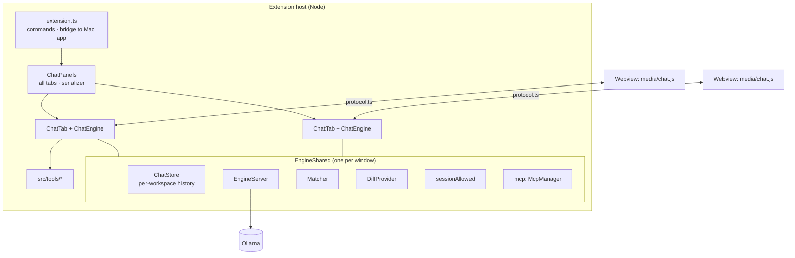

# Ingle for VS Code

Ingle's coding chat, as editor tabs in VS Code (and forks such as Cursor). It talks to the Ollama engine directly,
so **the Mac app doesn't need to be open**; if no engine answers, it starts the one bundled inside `Ingle.app`. It
shares `~/.ingle` with the Mac app: assistants, rules, skills, commands, memory, research and MCP servers.

- Code: [`../Extensions/vscode/`](../Extensions/vscode/) — TypeScript (strict), **no runtime npm dependencies**
  (Node and VS Code APIs only), a plain-JavaScript webview.
- Manifest: [`package.json`](../Extensions/vscode/package.json) — version `0.2.0`, `preview: true`, VS Code
  `^1.85.0`, activates on start-up and when a saved Ingle tab is restored.

## Architecture

### `EngineShared` vs per-tab `ChatEngine`

[`src/engine/chatEngine.ts`](../Extensions/vscode/src/engine/chatEngine.ts):

| `EngineShared` — one for all tabs | `ChatEngine` — one per tab |
|---|---|
| `store`: the chat history for this workspace | `currentId`: which chat this tab shows |
| `server`: finds or starts the engine; broadcasts its state to every tab | `generating`: this tab's running request and its `AbortController` |
| `matcher`: embedding cache for rules/skills/memory/reports | `pending`: this tab's approval card |
| `diff`: the `ingle-diff:` virtual documents | `activity`, editor tracking (`lastEditor`), context chip |
| `visionCache` per model | the agent loop: `send`, `generate`, `runLoop`, `runToolCall`, `runSubAgent`, `compact` |
| `sessionAllowed`: "Allow for this session", for every tab | slash commands, `/mcp`, attachments, insert/apply code |
| `engines`: every live `ChatEngine`, so a change in one tab refreshes the others' history (`chatsChanged`) | |

Each tab can run its own request at the same time as another tab; they share the one model.

### Tabs: `ChatPanels` and `ChatTab`

[`src/ui/chatView.ts`](../Extensions/vscode/src/ui/chatView.ts):

- The **Ingle icon** in the editor title bar (`ingle.newTab`, `editor/title` menu, `resources/ingle-ember.svg`)
  always opens **another** tab with a new chat. The first opens beside your code (`ingle.openBeside`); later ones
  join the column of the last Ingle tab.
- `ChatPanels.reveal()` focuses the last-used tab (or opens one); editor commands such as **Ask Ingle About This**
  go there.
- **↗ Pop out** (`ingle.popOut`) runs `workbench.action.moveEditorToNewWindow`.
- **Restore after restart:** `ChatPanels` is a `WebviewPanelSerializer`; the webview stores `chatId` in its state,
  and `deserializeWebviewPanel` reopens each tab on its chat.
- **Tab title = chat title.** `ChatTab.post` updates `panel.title` from `init`/`chats` messages ("Ingle" for a new
  chat). After the first reply, `summariseTitle` asks the model for a 2–6 word title (`think: false`,
  `num_ctx 4096`, 30 s timeout); the first line of your message is used until then.
- Webviews use `retainContextWhenHidden`, a strict CSP (`default-src 'none'`, nonce'd script, only `media/` as a
  resource root) and messages that arrive before the page says `ready` are queued (prefill, approval, status).

### Chat storage

[`src/engine/chatStore.ts`](../Extensions/vscode/src/engine/chatStore.ts): per workspace, in VS Code's global
storage, `chats-<first 16 hex of sha1(workspace path)>.json`. The 50 most recently updated non-empty chats are kept;
saves are atomic (write then rename) and coalesced while streaming (`saveSoon`, 1.5 s). Stored messages include the
raw `tool_calls` and base64 images needed to replay history to Ollama, plus hidden extras (extracted document text,
OCR, nudges) that the UI never sees (`forUI`).

## The webview protocol

[`src/shared/protocol.ts`](../Extensions/vscode/src/shared/protocol.ts) is the contract between the extension host
and [`media/chat.js`](../Extensions/vscode/media/chat.js). **Both sides must match.**

### Extension → webview (`ToWebview`)

| Type | Payload | Purpose |
|---|---|---|
| `init` | `state: UIState` | Everything to draw the tab: assistants, current assistant, Think/Web/context toggles, chat list, messages, editor context, engine state, vision, context usage, slash items, version |
| `messageAdd` | `message` | Append a message (user, assistant, tool row) |
| `messageDelta` | `id`, `content?`, `thinking?` | Stream text into a message |
| `messageUpdate` | `message` | Replace a whole message (final stats, tool output, chips) |
| `status` | `streaming`, `activity` | Spinner and activity line ("Running a command…") |
| `approval` | `approval: ApprovalRequest` | Show the approval card |
| `approvalClear` | — | Remove it |
| `context` | `context?` | Editor context chip (project, file, language, selection, problems) |
| `engine` | `state`, `text` | Engine starting / ready / offline |
| `chats` | `chats`, `chatId` | Refreshed history list |
| `prefill` | `text` | Put text in the message box |
| `attachments` | `attachments` | Add files picked with the paperclip |
| `contextUsage` | `used`, `limit` | Context meter |
| `slashItems` | `items` | Slash menu after `/skill-reload` |
| `mcp` | `servers: MCPServerInfo[]` | Open the `/mcp` dialog |
| `notice` | `text` | Short note under the composer (fades after ~4 s) |

### Webview → extension (`FromWebview`)

| Type | Payload | Purpose |
|---|---|---|
| `ready` | — | The page is listening; the host replies with `init` |
| `send` | `text`, `attachments?` | Send a message |
| `compact` | — | Compact chat |
| `slash` | `name` | A command from the `/` menu |
| `mcpRefresh` / `openMcpConfig` | — | `/mcp` dialog buttons |
| `pickFiles` | — | Paperclip: show the file picker |
| `stop` | — | Stop |
| `newChat` / `openChat` / `deleteChat` | `id` | History |
| `setAssistant` | `id` | `daily` or `hard` |
| `toggle` | `key: think \| web \| useContext`, `value` | Message-bar switches |
| `approve` | `id`, `decision: allow \| deny \| always` | Approval card |
| `showDiff` | `id` | **View Diff** on an approval |
| `insertCode` / `applyCode` | `code`, `language?` | Code block buttons |
| `copy` | `text` | Copy to the clipboard |
| `regenerate` | — | Regenerate the last reply |
| `startEngine` | — | Start the engine now |
| `openSettings` | — | Open `~/.ingle` |

Key shapes: `ChatMessage` (with `tool`, `usedContext`, `stats`, `thoughtSeconds`, `attachments`, `compaction`),
`ApprovalRequest` (`kind`: command, write, edit, open, mcp, memory, skill, rule, read; `title`, `detail`,
`preview`, `canShowDiff`), `UIState`, `MCPServerInfo`.

**The webview** is plain JavaScript with no frameworks or CDNs: a tiny `h()` element builder, a safe Markdown
renderer that escapes everything before adding markup, syntax colouring, the composer (paste, drag and drop, the
paperclip; hold Shift when dropping from Finder, or VS Code opens the file instead), slash menu, context meter
(ring + percentage, click for details and **Compact chat**), approval card, `/mcp` modal, history menu, and an
ARIA live region for announcements.

## Tools

All tools implement `ToolDef` ([`src/tools/types.ts`](../Extensions/vscode/src/tools/types.ts)): `name`,
`description`, JSON-schema `parameters`, `readOnly` (helpers may use it), `available(ctx)`, `describe(args)` (the
row in the chat) and `run(args, ctx)`, which **asks for approval itself** through `ctx.requestApproval` and never
throws. The list is in [`src/tools/index.ts`](../Extensions/vscode/src/tools/index.ts); the engine adds `delegate`.

| Tool | File | Read-only | Approval |
|---|---|---|---|
| `repo_map` | [`repomap.ts`](../Extensions/vscode/src/tools/repomap.ts) | yes | no |
| `read_file`, `list_files` | [`files.ts`](../Extensions/vscode/src/tools/files.ts) | yes | outside the project |
| `find_files`, `search_code`, `get_problems` | `files.ts` | yes | no |
| `edit_file`, `write_file` | `files.ts` | no | always, with diff |
| `read_document`, `view_image` | [`documents.ts`](../Extensions/vscode/src/tools/documents.ts) | yes | outside the project |
| `run_command`, `open_url` | [`command.ts`](../Extensions/vscode/src/tools/command.ts) | no | always |
| `web_search`, `web_fetch` | [`web.ts`](../Extensions/vscode/src/tools/web.ts) | yes | no (Web on only) |
| `memory_search`, `memory_read`, `memory_save`, `memory_rewrite`, `memory_forget` | [`memory.ts`](../Extensions/vscode/src/tools/memory.ts) | search/read | saves if "ask first" |
| `use_skill`, `use_rule`, `report_search`, `report_read`, `report_save`, `skill_create`, `rule_create` | [`knowledge.ts`](../Extensions/vscode/src/tools/knowledge.ts) | reads | creates always |
| `command_create` | [`commands.ts`](../Extensions/vscode/src/tools/commands.ts) | no | always |
| `mcp_tools`, `mcp_call` | [`mcp.ts`](../Extensions/vscode/src/tools/mcp.ts) | `mcp_tools` | `mcp_call` always |
| `delegate` | `chatEngine.ts` | — | no |

Per-turn selection and the guards are described in [agent-loop.md](agent-loop.md#3-tool-selection).

### Editing files safely

- **`edit_file(path, old_text, new_text)`** uses `planEdit`
  ([`editmatch.ts`](../Extensions/vscode/src/tools/editmatch.ts)): an exact unique match first; then exact after
  converting to the file's line endings; then a line-by-line match that ignores trailing whitespace and `\r` (the
  first line may start mid-line, the last may end mid-line). More than one match → "appears N times, include more
  lines". No match → the **closest lines** (bigram similarity, with line numbers) so the model can correct itself.
  `new_text` is converted to the file's line endings.
- **Approval** shows a unified diff ([`tools/diff.ts`](../Extensions/vscode/src/tools/diff.ts)) and a **View Diff**
  button, which opens VS Code's diff editor between the current text (including unsaved changes) and the proposal,
  using in-memory `ingle-diff:` documents ([`engine/diff.ts`](../Extensions/vscode/src/engine/diff.ts)).
- **Applying** (`applyText`): if the document changed while you were deciding, the edit is refused ("changed while
  waiting for approval"); otherwise only the changed middle is replaced through a `WorkspaceEdit` (so **Undo** works
  and cursors elsewhere stay put) and the file is saved.
- **`write_file`** shows the new content (and a diff when overwriting); new files are written to disk with folders
  created.

### Repo map

[`src/tools/repomap.ts`](../Extensions/vscode/src/tools/repomap.ts) — like Aider's repo map, without tree-sitter.

- **Indexing:** up to 4,000 code files from `findFiles` (skipping `node_modules`, `.git`, build folders, minified
  files, `.d.ts`, vendor and virtual-env folders); files over 300 KB get no symbols. Symbols come from
  per-language regular expressions (TypeScript/JavaScript/Vue/Svelte exports, classes, public methods, functions,
  Express routes; Swift types and non-private functions; C#, Python, Go, Rust, Kotlin/Java, Ruby, PHP, Dart and
  others) and relative imports. Results are cached by modification time.
- **Ranking for each request:** active file +100, open tabs +40, changed in `git status` +30, imported by the active
  file +25, imports the active file +20, each query word in the path +15 or in the symbols +8, entry-point names +5,
  minus folder depth, minus 5 for no symbols.
- **Output:** "N code files. Folders: …", then the top files with up to 14 symbols each, until the budget, then "…and
  N more files". Every request gets a map within `min(6000, 0.4 × context)` characters when a project is open and the
  context chip is on; the `repo_map(focus, folder)` tool returns up to 16,000 characters.

### Attachments, documents and images

`prepareAttachments` in `chatEngine.ts` and [`documents.ts`](../Extensions/vscode/src/tools/documents.ts):

- Paste, drag and drop (webview sends base64, ≤ 20 MB) or the paperclip (the host sends paths).
- **Documents** become text that only the model sees (`extraContext`): PDFs via a JXA script using PDFKit, Word/RTF
  via `textutil`, iWork via `mdls`/the preview, `.xlsx` via `unzip` and a small XML reader, `.pptx` via `unzip`,
  text files directly.
- **Images** are converted with `sips` to a 1,600 px JPEG plus a 256 px thumbnail; vision models get the image,
  others get OCR text from Vision via JXA.
- These helpers use macOS's built-in tools. On other platforms the extension says "This needs macOS" for PDFs,
  Word, OCR and HEIC (plain text, `.docx` via `unzip`, `.xlsx` and `.pptx` still work). See
  [weaknesses-and-mitigations.md](weaknesses-and-mitigations.md#4-mac-only-reach).

### Code actions

Code blocks in replies have **Copy**, **Insert** (at the cursor in the last-used editor) and **Apply**: replace the
selection if there is one, otherwise show a whole-file diff and ask "Replace all of X with Ingle's code?" before
applying it as one edit.

### MCP

[`src/tools/mcp.ts`](../Extensions/vscode/src/tools/mcp.ts) is a small stdio MCP client shared by all tabs:

- Servers come from the same three configs as the Mac app (`mcpServers()` in
  [`stores.ts`](../Extensions/vscode/src/tools/stores.ts)); servers switched off in the Mac app (`mcpDisabled`) are
  skipped.
- Started **lazily** on first use, **directly** (not through a shell), in the workspace folder, with `PATH` extended
  by `/opt/homebrew/bin`, `/usr/local/bin` and `~/.local/bin` (GUI-launched editors often miss them).
- JSON-RPC 2.0 over newline-delimited stdio, protocol `2025-06-18`, `tools/list` with pagination, 90 s for the first
  start (`npx -y` downloads), 30 s per request, results capped at 20,000 characters.
- A server that crashes is restarted once; after a second crash it stays stopped until **Reload** in `/mcp`.
- The `/mcp` dialog shows servers this window has connected, otherwise the Mac app's live status from
  `settings.json` ("Connected in the Ingle app — VS Code starts its own when a chat uses it").
- `mcp_call` checks the server and tool exist **before** asking you, then shows the arguments as JSON on the card.

## Commands and keybindings

| Command | Title | Where |
|---|---|---|
| `ingle.newTab` | New Ingle Chat Tab | Ingle icon in the editor title bar |
| `ingle.focus` | Ingle: Open Chat | ⌘⌥L |
| `ingle.popOut` | Pop Out Chat into a New Window | ↗ in the title bar of an Ingle tab |
| `ingle.newChat` | Ingle: New Chat | |
| `ingle.askSelection` | Ask Ingle About This | ⌘⌥I in an editor; right-click with a selection |
| `ingle.explainProblem` | Ask Ingle to Explain This Problem | right-click |
| `ingle.fixProblem` | Ask Ingle to Fix This Problem | Command Palette |
| `ingle.openHome` | Open Ingle Folder (rules, skills, memory) | |
| `ingle.forgetApprovals` | Ask Before Every Action Again | clears session allowances |
| `ingle.terms`, `ingle.privacy`, `ingle.about` | Terms of Use, Privacy Policy, About Ingle | open the bundled legal files |

**Explain/Fix This Problem** picks the diagnostic on (or nearest to) the cursor line and sends it with 20 lines either
side. **Ask Ingle About This** prefills a new chat with the selection (or the lines around the cursor).

## Settings

| Setting | Default | Meaning |
|---|---|---|
| `ingle.shareWithApp` | `true` | Tell the Mac app (if open) which project and file you're in |
| `ingle.port` | `47123` | The Mac app's bridge port |
| `ingle.shareSelection` | `true` | Include your selection in what the Mac app sees |
| `ingle.shareProblems` | `true` | Include errors and warnings in what the Mac app sees |
| `ingle.openBeside` | `true` | Open the first tab beside your code |
| `ingle.maxSteps` | `200` | Backstop for steps in one request; `0` = no limit |

Everything else (assistants, models, context lengths, web, memory, workspace folders, engine) comes from
`~/.ingle/settings.json`, written by the Mac app.

## Installing: `install.sh`

[`install.sh`](../Extensions/vscode/install.sh):

1. `npm install` (build tools only: TypeScript, `@vscode/vsce`, type definitions).
2. `npm run compile` (`tsc -p ./` into `out/`).
3. Copy `TERMS.md`, `PRIVACY.md`, `LICENSE.md`, `LICENSING.md` into `legal/` (and `LICENSE.md` beside
   `package.json`).
4. If `VSCODE_PUBLISHER` is set in `../../local.env`, temporarily rewrite the publisher in `package.json` (restored on
   exit) — keep it stable, or VS Code treats it as a new extension with empty history.
5. `vsce package` → `ingle.vsix`.
6. Uninstall the old *Ingle Bridge* extension if present, then `code --install-extension ingle.vsix --force`. Without
   the `code` command, install the VSIX from the Extensions view.

Then reload VS Code and click the orange Ingle icon at the top right of any open file.

## File-by-file map

| Path | What's in it |
|---|---|
| [`src/extension.ts`](../Extensions/vscode/src/extension.ts) | Activation, command registration, the bridge to the Mac app (`postToApp`, `snapshot`, debounced context), Explain/Fix/Ask helpers |
| [`src/ui/chatView.ts`](../Extensions/vscode/src/ui/chatView.ts) | `ChatPanels`, `ChatTab`, webview HTML and CSP |
| [`src/engine/chatEngine.ts`](../Extensions/vscode/src/engine/chatEngine.ts) | `EngineShared`, `ChatEngine`: state, chats, slash, `/mcp`, vision, editor context, matching, tool selection, approvals, attachments, sending, titles, the loop, trimming, tool calls, helpers, compaction, code actions |
| [`src/engine/prompt.ts`](../Extensions/vscode/src/engine/prompt.ts) | `personaPrompt`, `indexPrompt`, `editorPrompt`, `projectInstructions`, `guidancePrompt`, `subAgentPrompt`, `COMPACT_PROMPT`, `companionFact` |
| [`src/engine/ollama.ts`](../Extensions/vscode/src/engine/ollama.ts) | `OllamaClient` (version, tags, capabilities, embed, streaming chat with think retry), `tuning()` |
| [`src/engine/server.ts`](../Extensions/vscode/src/engine/server.ts) | `EngineServer`: check, start the bundled engine, offline polling |
| [`src/engine/chatStore.ts`](../Extensions/vscode/src/engine/chatStore.ts) | Per-workspace chat storage |
| [`src/engine/matcher.ts`](../Extensions/vscode/src/engine/matcher.ts) | Embedding and keyword matching (port of `SemanticMatcher.swift`) |
| [`src/engine/names.ts`](../Extensions/vscode/src/engine/names.ts) | `prettyModel`, `roleName` |
| [`src/engine/diff.ts`](../Extensions/vscode/src/engine/diff.ts) | `DiffProvider` for `ingle-diff:` documents |
| [`src/tools/types.ts`](../Extensions/vscode/src/tools/types.ts) | `ToolDef`, `ToolContext`, `ToolResult`, `toOllama`, `str` |
| [`src/tools/index.ts`](../Extensions/vscode/src/tools/index.ts) | `allTools()` |
| [`src/tools/files.ts`](../Extensions/vscode/src/tools/files.ts) | read, list, find, search, problems, edit, write |
| [`src/tools/editmatch.ts`](../Extensions/vscode/src/tools/editmatch.ts) | `planEdit`, `nearestLines` |
| [`src/tools/diff.ts`](../Extensions/vscode/src/tools/diff.ts) | Unified diff and stats for approval previews |
| [`src/tools/paths.ts`](../Extensions/vscode/src/tools/paths.ts) | Path resolution, project roots, symlink-safe "inside the project" checks, `checkRead`, `DENIED` |
| [`src/tools/command.ts`](../Extensions/vscode/src/tools/command.ts) | `run_command` (`runShell`), `open_url` |
| [`src/tools/documents.ts`](../Extensions/vscode/src/tools/documents.ts) | `extractDocument`, `prepareImage`, OCR, `read_document`, `view_image` |
| [`src/tools/web.ts`](../Extensions/vscode/src/tools/web.ts) | `web_search`, `web_fetch` with DNS and redirect checks |
| [`src/tools/html.ts`](../Extensions/vscode/src/tools/html.ts) | HTML to text, private host and address checks |
| [`src/tools/memory.ts`](../Extensions/vscode/src/tools/memory.ts) | Memory tools |
| [`src/tools/knowledge.ts`](../Extensions/vscode/src/tools/knowledge.ts) | Skills, rules, reports, builders |
| [`src/tools/commands.ts`](../Extensions/vscode/src/tools/commands.ts) | Commands store, wording, checks, `command_create` |
| [`src/tools/mcp.ts`](../Extensions/vscode/src/tools/mcp.ts) | `McpConnection`, `McpManager`, `mcp_tools`, `mcp_call` |
| [`src/tools/repomap.ts`](../Extensions/vscode/src/tools/repomap.ts) | Symbol extraction, ranking, `buildRepoMap`, `repo_map` |
| [`src/tools/stores.ts`](../Extensions/vscode/src/tools/stores.ts) | Reading and writing `~/.ingle`: rules, skills, memory, reports, MCP config, notes |
| [`src/tools/frontmatter.ts`](../Extensions/vscode/src/tools/frontmatter.ts) | Frontmatter, slugs, `looksSecret`, atomic writes (ports of the Swift helpers) |
| [`src/shared/protocol.ts`](../Extensions/vscode/src/shared/protocol.ts) | Webview message contract |
| [`src/shared/settings.ts`](../Extensions/vscode/src/shared/settings.ts) | `IngleSettings`, defaults, `loadSettings`, `paths` |
| [`media/chat.js`](../Extensions/vscode/media/chat.js), [`media/chat.css`](../Extensions/vscode/media/chat.css) | The webview UI |
| [`resources/`](../Extensions/vscode/resources/) | Marketplace icon, title-bar icon, tab icon |
| [`install.sh`](../Extensions/vscode/install.sh) | Build, package and install |

## Trade-offs

| We chose | We gave up | Why |
|---|---|---|
| **Editor tabs** (webview panels) rather than a sidebar view or VS Code's Chat API | Native chat UI, `vscode.lm` integration | Tabs can sit beside code, be duplicated and popped out, and work the same in forks (Cursor, VSCodium) that may not implement Microsoft-only APIs. |
| **A self-contained webview in plain JS** | React and component libraries | No runtime dependencies, a strict CSP, fast load, nothing to audit from npm. More manual DOM code to maintain. |
| **Regex symbol extraction** for the repo map | Tree-sitter's accurate, language-aware parsing | Tree-sitter needs native or WASM grammars per language — heavy, and against the no-dependencies rule. Regexes cover the common declarations in ~20 languages at a fraction of the size; they miss some (nested or unusual syntax) and occasionally pick up noise. Ranking by the active file, open tabs, git changes and query words matters more than perfect symbols. |
| **`EngineShared` + per-tab `ChatEngine`** | Fully independent tabs | One history, one engine connection and one MCP manager avoid duplicate processes and conflicting writes; per-tab engines keep each tab's chat, reply and approval separate. |
| **Session allowances shared by all tabs** | Per-tab or per-chat scope | Matches the Mac app and the mental model "this VS Code session"; one command clears them all. |
| **Per-workspace chat history in VS Code's storage** | Sharing chats with the Mac app | VS Code manages the storage; history follows the project. Shared storage in `~/.ingle` is planned. |
| **macOS command-line tools** for documents and images (`textutil`, `sips`, JXA + PDFKit/Vision) | Portability | Zero dependencies and Apple's best-in-class OCR. On Windows/Linux these features say "needs macOS"; a pluggable extractor is on the [roadmap](roadmap.md#windows-and-linux-for-the-extension). |
| **Reading `settings.json`** rather than having its own settings UI | Editing assistants from VS Code | One writer (the Mac app); sensible defaults when it's absent. Without the Mac app, the defaults are fixed until a settings UI exists. |
